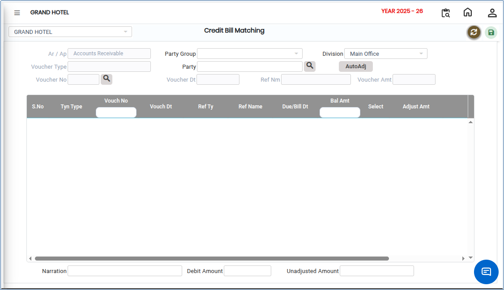
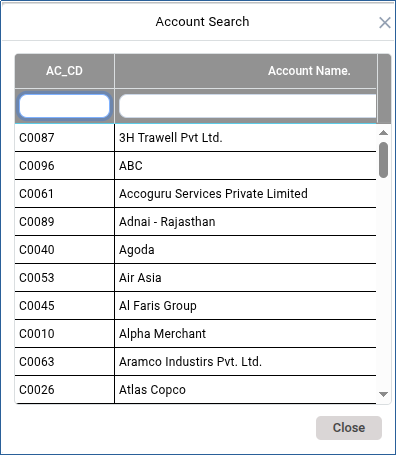
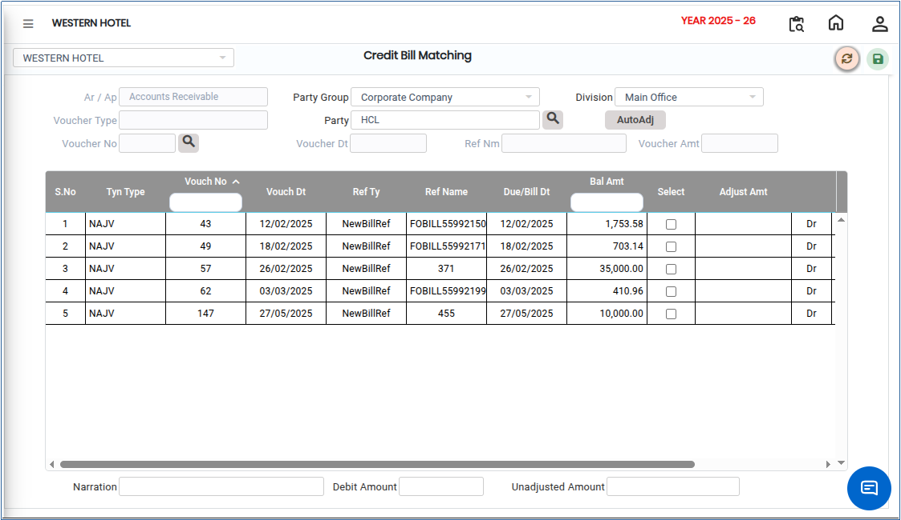

# Credit Bill Matching

**Credit Bill Matching** is the process of verifying and reconciling credit bills or credit notes received from vendors against the corresponding invoices, vouchers, purchase transactions, or payment records. This process helps ensure the accuracy of financial records and proper accounting before posting adjustments to accounts.

## Steps to Perform Credit Bill Matching

Step 1: Navigate to the **General Ledger** module.

1. Click **Party Outstanding** from the menu.
2. Select **Credit Bill Matching** option.

* The credit bill matching screen will be displayed.

<figure><figcaption></figcaption></figure>

Step 2: Click the **Party Group** drop-down.

1. Select the required group from the available list.

<figure><figcaption></figcaption></figure>

Step 3: After selecting the Party Group, choose the **Party Name** for whom the credit bill matching needs to be performed.

* &#x20;The screen displays the available credit bills and related voucher details that can be matched.

<figure><figcaption></figcaption></figure>

Step 4: Select the appropriate **Voucher Number** from the available records.

1. Verify the corresponding **Bill Amount**.
2. Match the credit bill with the correct voucher transaction.

Step 5: Once the required voucher and bill amount have been selected and verified:

1. Click the **Save** button.

* The system will save the matching details.

