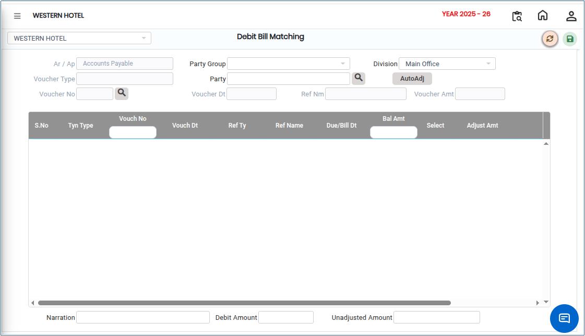
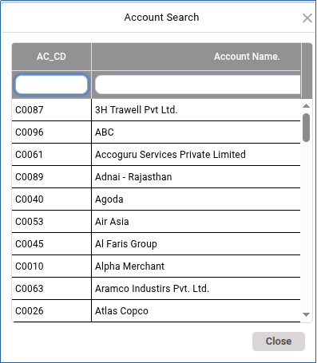

# Debit Bill Matching

**Debit Bill Matching** is the process of verifying and reconciling debit bills or debit memos issued to vendors or received from them against the corresponding invoices, purchase orders, vouchers, or payment records. This process helps ensure the accuracy of financial transactions and proper accounting before posting adjustments to accounts.

## Steps to Perform Debit Bill Matching

Step 1: Navigate to the **General Ledger** module.

1. Click **Party Outstanding** from the menu.
2. Select **Debit Bill Matching** option.

* The debit bill matching screen will be displayed.

<figure><figcaption></figcaption></figure>

Step 2: Click the **Party Group** drop-down.

1. Select the required group from the available list.

<figure><figcaption></figcaption></figure>

Step 3: After selecting the Party Group, choose the **Party** for whom the debit bill matching needs to be performed.

* The screen displays the available debit bills and related voucher details that can be matched.

Step 4: Select the appropriate **Voucher Number** from the available records.

1. Verify the corresponding **Bill Amount**.

* Ensure that the selected voucher number corresponds to the correct debit bill.

Step 5: Once the required voucher and bill amount have been selected and verified:

1. Click the **Save** button..png>)
2. The system will save the matching details.
