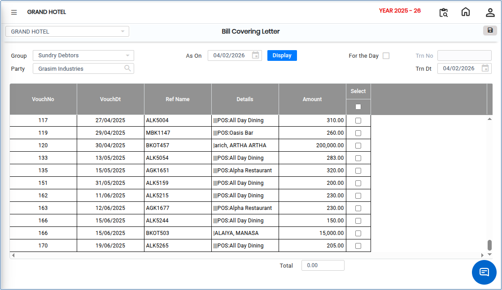

# Bill Covering Letter

The **Bill Covering Letter** feature allows users to generate a consolidated covering letter for **Receivable (Accounts)** transactions. This letter can be generated for a specific party and can include one or multiple bills that have been issued to that party.

The covering letter serves as a formal document accompanying the selected bills and can be shared with customers for payment follow-up and record purposes.

## Steps to Generate a Bill Covering Letter

Step 1: Navigate to the **General Ledger** module.

1. Click **Party Outstanding** from the menu.
2. Select **Bill Covering Letter** option.

* The bill covering letter screen will be displayed.

<figure><figcaption></figcaption></figure>

Step 2: Click the **Group** drop-down.

1. Select the required group from the available list.

<figure><figcaption></figcaption></figure>

Step 3: After selecting the group, choose the **Party** for whom the covering letter needs to be generated.

<figure><figcaption></figcaption></figure>

Step 4: Select the required date range.

1. If needed, search for bills generated on a specific transaction date.
2. Click the **Display** button.

* The system will display all available receivable bills for the selected party based on the chosen date criteria.

Step 5: Select the bill(s) that need to be included in the covering letter.

<figure><figcaption></figcaption></figure>

Step 6: After selecting the required bills:

1. Click the **Save** icon.

* The system will generate a consolidated Bill Covering Letter containing the selected bills.
