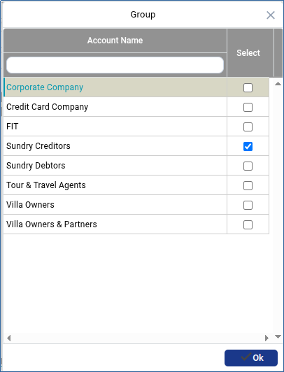

# Statement of Accounts

The **Statement of Accounts Report** allows users to view detailed account statements for individual parties or party groups. This report helps track receivable and payable transactions, outstanding balances, and account activities within a specified period.

## Steps to Generate the Statement of Accounts Report

Step 1: Navigate to the **General Ledger** module.

1. Click **Party Outstanding** from the menu.
2. Select **Statement of Accounts** option.

* The statement of accounts screen will be displayed.&#x20;

<figure><figcaption></figcaption></figure>

Step 2: Use the available filter options to specify the type of transactions you want to view.

* Available options may include **Receivable, Payable** or **Both.**

<figure><figcaption></figcaption></figure>

Step 3: Click the **Group** drop-down.

1. Select the required group from the available list.

<figure><figcaption></figcaption></figure>

Step 4: The report provides advanced filtering options to generate more specific account statements such as **Specific Party, Reference Date** and **Date Range.**

<figure><figcaption></figcaption></figure>

Step 5: After selecting the required filters, click the **Display** button.

* The system will generate the Statement of Accounts Report based on the selected criteria.

Step 6: After generating the report :&#x20;

* Click the **Print** button .png>)to generate the report in a printable document format.
* Click the **Excel** button .png>) to export the report to Microsoft Excel format for further analysis and reporting.
