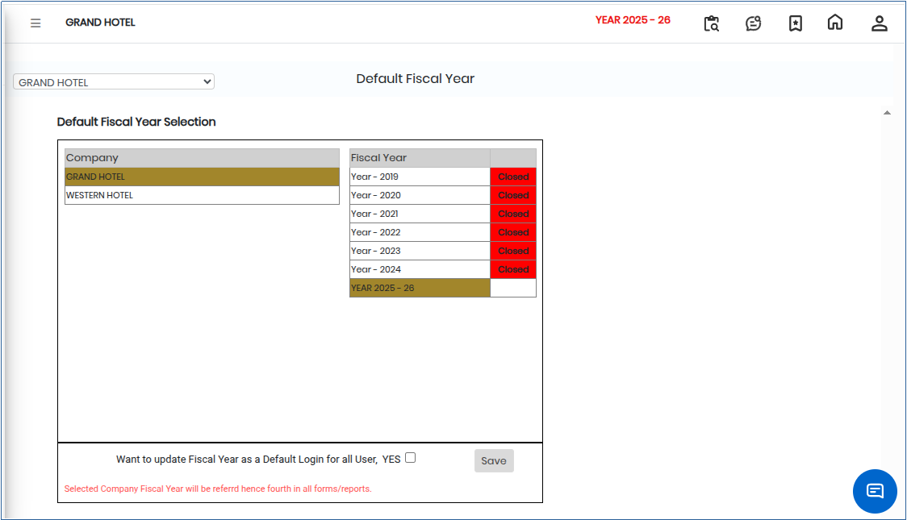
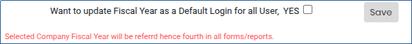

# Default Fiscal Year Selection

The **Default Fiscal Year** option is used to define the primary fiscal year that will be used by the system for viewing reports, performing transactions, and making changes within the selected module.

When multiple fiscal years are available and active, the system will use the selected default fiscal year as the primary reference for all financial operations.

## Steps to Set Default Fiscal Year

Step 1: Navigate to the **General Ledger** module.

1. Click **Settings** from the menu.
2. Select **Default Fiscal Year**.

* The Default Fiscal Year screen will be displayed.

Step 2: Choose the required **Fiscal Year** from the available list.

Step 3: After selecting the fiscal year, click the **Save** button.

* The selected fiscal year will be set as the default for the system or module.

<figure><figcaption></figcaption></figure>

* If the **checkbox for global application** is enabled, the selected default fiscal year setting will be applied for **all users in the system**.

<figure><figcaption></figcaption></figure>
