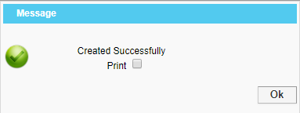

# Miscellaneous Sales

**Miscellaneous Sales**

This option is used to make bills for outsiders. By using this option, the user can create and settle bills for an outsider

**Steps to Miscellaneous Sales**

1.Go to **Cashier Main Menu**.

2.Click on **Cashier > Miscellaneous Sales.**

.png>)

1. Once you click on Miscellaneous sales you will see the below screen.
2. Now the user needs to select the outlet as per their requirement . Once the user has selected the outlet you can see the revenue also. Enter the charge amount and settlement mode as shown below.
3. Once all the fields are filled in click on the save button and you will get the message box as shown below.

