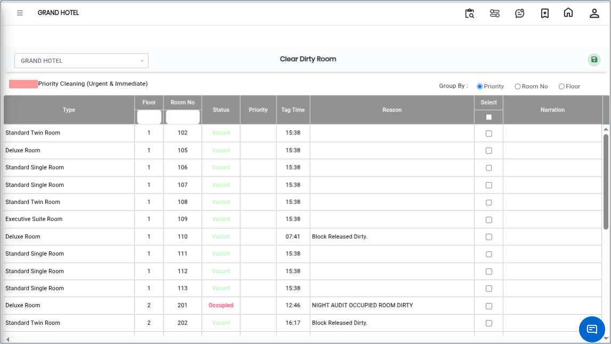

# Clear Dirty Room

The **Clear Dirty Room** option is used to remove the “Dirty” status from rooms after housekeeping cleaning is completed.

**Important Note**

* If a room status is marked as **Dirty**, the system will not allow guest check-in for that room.
* Therefore, it is mandatory to clear the dirty room status before assigning the room to a guest.

## Steps to Clear a Dirty Room

Step 1: Go to the **Housekeeping Main Menu**.

1. Click on **Transaction**.
2. Select **Clear Dirty Room**.

* The system displays the list of rooms currently marked as **Dirty**.

<figure><figcaption></figcaption></figure>

Step 2: Select the **Dirty Room Number** that needs to be cleared.

Step 3: Provide the required narration or remarks(Example: Room cleaned and ready, Housekeeping completed, Inspection completed).

* Proper narration helps maintain housekeeping records and operational tracking.

<figure><figcaption></figcaption></figure>

Step 4: Click on the **Save** button to clear the dirty room status.

* Once saved successfully, the room status will be updated and the room will no longer appear as dirty.

<figure><figcaption></figcaption></figure>
