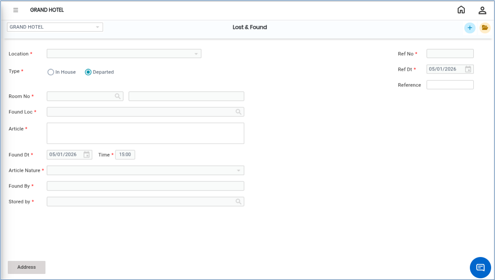
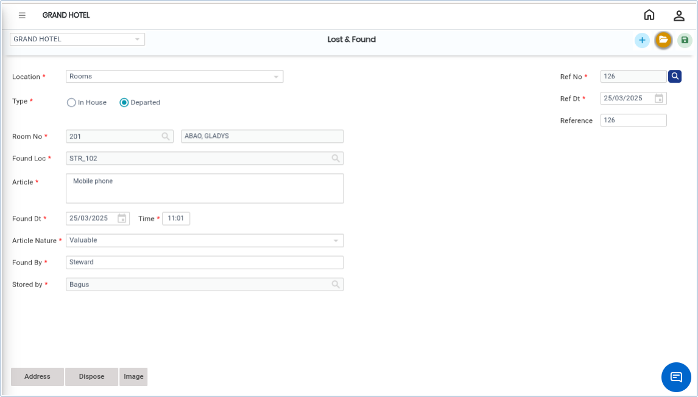

# Lost & Found

The **Lost & Found** transaction is used to record details of items found within the property. This helps maintain proper tracking, follow-up, and reporting of lost items.

* All entered details can later be used to generate reports and communicate with guests regarding their belongings.

## Steps to Create a Lost & Found Entry

Step 1: Go to the **Housekeeping** **Main Menu**.

1. Under **Transactions**, click on **Lost & Found**.

<figure><figcaption></figcaption></figure>

Step 2: Choose the **Location Type** from the available list.

<figure><figcaption></figcaption></figure>

**Important Note**

* If the selected location type is **Room**, the system allows you to search and select the guest name from the **Checked-Out Room List**.

#### Field Description

Fill in the following details carefully:

1. Enter the guest’s name.

* If the location type is **Room**, you can search and select the guest from the checked-out guest list.

2. Enter the exact location where the item was found.
3. By default, the system displays the current system date.

* You can modify the date if required.

4. Enter the time in **HH:MM** format.

* The current system time appears automatically and can be changed if necessary.

5. Enter detailed information about the found item.

* Maximum allowed: **200 characters**(Example: Black leather wallet, Silver wristwatch, Mobile charger).

6. Enter the name of the person who reported or found the item.
7. Enter the name of the person who stored or secured the item.
8. Enter the guest’s address.

**Important Note**

* For checked-out guests, the address is automatically fetched from the guest profile.

9. A **Lost & Found Letter** can be printed if this option is enabled in the Master Settings.

* The print format can be customized according to the client’s requirements.

Step 3: After entering all required details, click the **Save** button..png>)

* Once saved successfully, the system updates the Lost & Found entry and displays a confirmation message.

<figure><figcaption></figcaption></figure>
