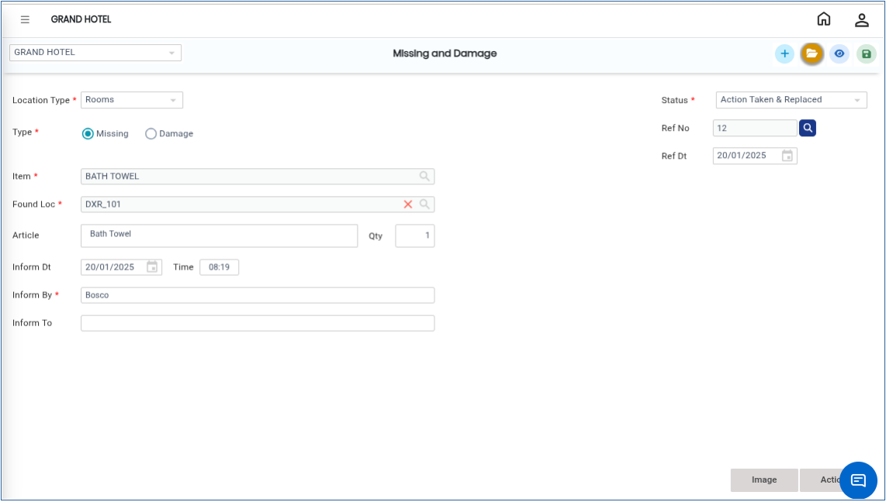

# Missing & Damage

The **Missing & Damage** transaction is used to record details of missing or damaged items in guest rooms or public areas. These items may include special amenities, linen items, or any property belonging to the hotel.

## Steps to Create a Missing & Damage Entry

Step 1: Go to the **Housekeeping Main Menu**.

1. Under **Transactions,** click on **Missing & Damage**.

<figure><figcaption></figcaption></figure>

#### Field Description

Enter the following details carefully:

1. By default, the system displays the current system date.

* The date can be changed to a previous or future date if required.

2. Select the missing or damaged item from the available list.

* The item search displays items based on the configured master settings.

3. Enter the quantity of the missing or damaged item.
4. Enter the name of the person who reported the issue.
5. By default, the system displays the current system date and time.

* This can be modified if necessary.

6. Enter the name of the person who has been informed about the missing or damaged item(Example: Housekeeping Supervisor, Front Office Manager, Maintenance Team).
7. Select whether the transaction is for **Missing Item** or **Damaged Item.**
8. Select the location type where the issue occurred.

* Based on the selected location type, the location list will be filtered automatically(Example: Room, Lobby, Restaurant, Public Area).

9. Enter detailed information about the missing or damaged item.

* Maximum allowed: **250 characters**(Example: White bath towel missing from Room 205. Electric kettle damaged and not functioning).

10. Select the action taken for the transaction.Available Options:

* Charged to Staff
* Charged to Guest
* Charged to Company

11. Enter the amount charged for the item.

**Important Note**

* This amount is not validated by the system.
* It is entered mainly for housekeeping reference and communication with the front office department.

12\. Enter the replacement date for the missing or damaged item.

13.While saving the transaction, the system automatically generates a **DOC No** for reference and tracking.

Step 2: After entering all required details, click the **Save** button.

* Once saved successfully, the Missing & Damage transaction will be recorded in the system.

<figure><figcaption></figcaption></figure>
