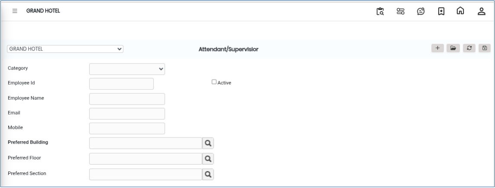
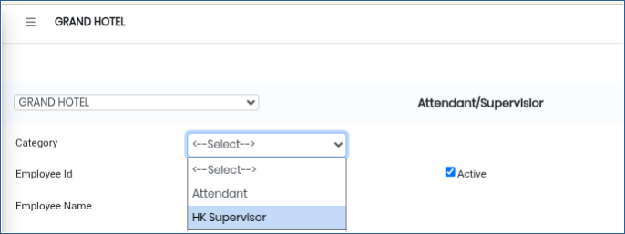
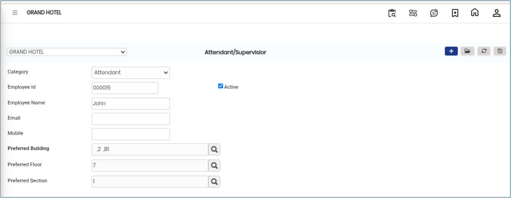
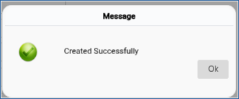

# Attendant/Supervisor

The **Attendant / Supervisor** option in the Room Cleaning module is used to create and manage housekeeping staff details within the system.This feature helps assign room attendants or Housekeeping supervisors.

* These staff members can later be linked to room cleaning operations, task assignments, inspections, and housekeeping activities.

## Steps to Create an Attendant / Supervisor

Step 1: Go to the **Housekeeping Main Menu**.

1. Click on **Room Cleaning**.
2. Select **Attendant / Supervisor**.

* The Attendant / Supervisor management screen will appear.

<figure><figcaption></figcaption></figure>

Step 2: Click on the **New** button.

Step 3: Choose the required category from the available options.

<figure><figcaption></figcaption></figure>

Step 4: Enter the required staff information.

<figure><figcaption></figcaption></figure>

Step 5: After entering all required details, click on the **Save** button.

* Once saved successfully, the Attendant or Supervisor record will be created in the system.

<figure><figcaption></figcaption></figure>
