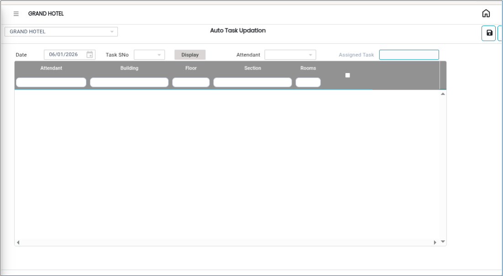
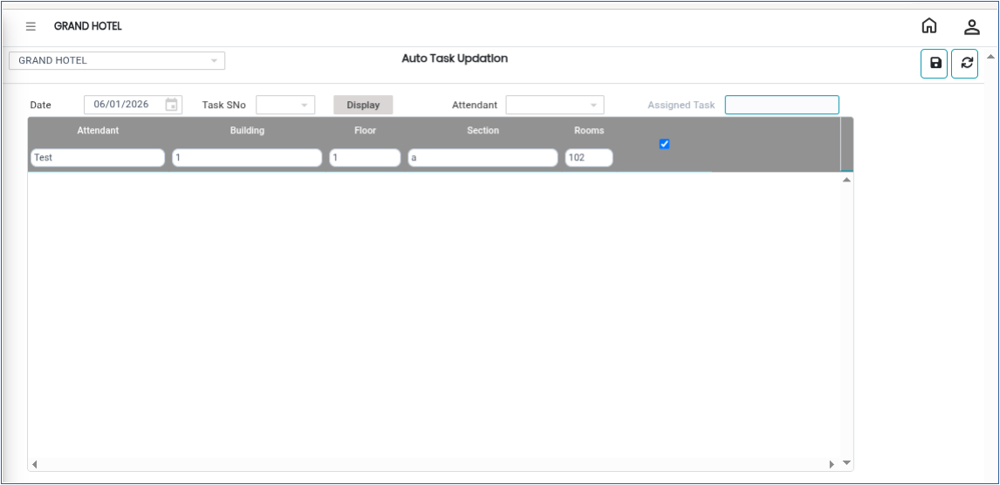

# Auto Task Updation

The **Auto Task Updation** feature in the Room Cleaning module is used to automatically allocate or update housekeeping tasks within the system.This feature helps streamline housekeeping operations by assigning predefined cleaning or maintenance tasks to rooms or staff members efficiently.

## Steps for Auto Task Updation

Step 1: Go to the **Housekeeping Main Menu**.

1. Click on **Room Cleaning**.
2. Select **Auto Task Updation**.

* The Auto Task Updation screen will appear.

<figure><figcaption></figcaption></figure>

Step 2: Select or allocate the required housekeeping tasks.

<figure><figcaption></figcaption></figure>

Step 3: After verifying the task allocation details, click on the **Save** button.

* Once saved successfully, the tasks will be updated and allocated in the system.

<figure><figcaption></figcaption></figure>
