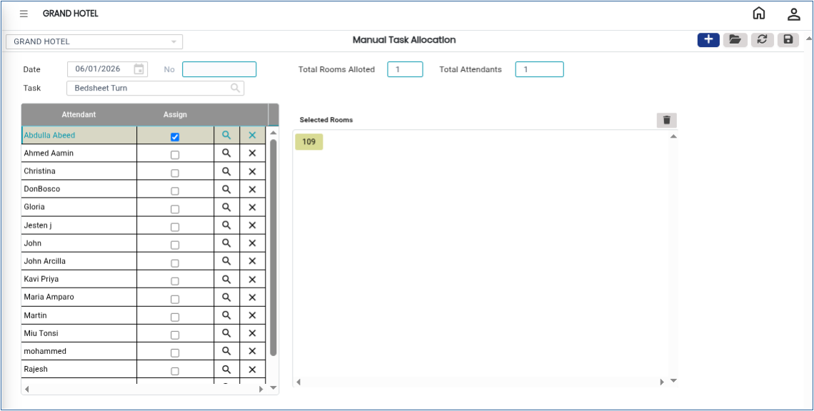

# Manual Task Allocation

**Manual Task Allocation** is a feature in the Housekeeping module that allows supervisors or administrators to manually assign room cleaning tasks to housekeeping staff. Using this option, you can select a task type, choose the staff member responsible for the task, search for rooms, and assign the task accordingly.

## Steps for Manual Task Allocation

Step 1: Login to the application and go to the **Housekeeping** main menu.

1. Click on **Room Cleaning**.
2. Select **Manual Task Allocation** from the sub menu.

* You will now see the **Manual Task Allocation** screen.

<figure><figcaption></figcaption></figure>

Step 2: Click on the **Task** dropdown field.

1. Choose the required task from the available options.

* The selected task will be displayed on the screen.

<figure><figcaption></figcaption></figure>

Step 3: Click on the **Assign Person** field.

1. Select the housekeeping staff member to whom the task should be assigned.

* Make sure the correct staff member is selected before proceeding.

<figure><figcaption></figcaption></figure>

Step 4: After selecting the task and assign person, click on the **Search** button.

1. The system will display the list of available rooms based on the selected criteria.

<figure><figcaption></figcaption></figure>

Step 5: Select the room(s) from the displayed list.

1. Verify the task details and assigned staff member.

* Ensure all information is correct before saving.

<figure><figcaption></figcaption></figure>

Step 6: Click on the **Save** button.

* The task will now be successfully assigned to the selected housekeeping staff member.
