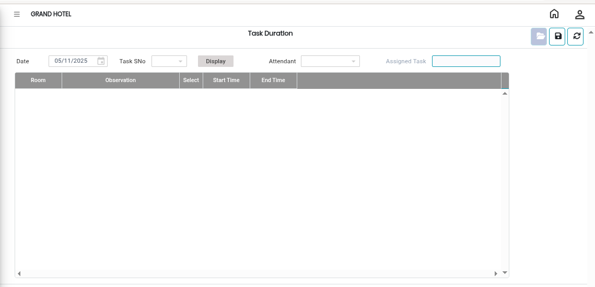

# Task Duration

The **Task Duration** option in the Room Cleaning module is used to define or update the time duration required for housekeeping tasks.By assigning duration to tasks, supervisors can better allocate work to attendants and ensure timely room readiness.

## Steps for Task Duration Setup

Step 1: Go to the **Housekeeping Main Menu**.

1. Click on **Room Cleaning**.
2. Select **Task Duration**.

* The Task Duration screen will appear.

<figure><figcaption></figcaption></figure>

Step 2: Click on the **Open** button.

Step 3: Choose the required task from the list.

Step 4: Enter or verify the duration required for the selected task.

* Task duration should be entered based on standard housekeeping procedures.

Step 5: Click on the **Save** button.

* Once saved successfully, the task duration will be updated in the system.

<figure><figcaption></figcaption></figure>
