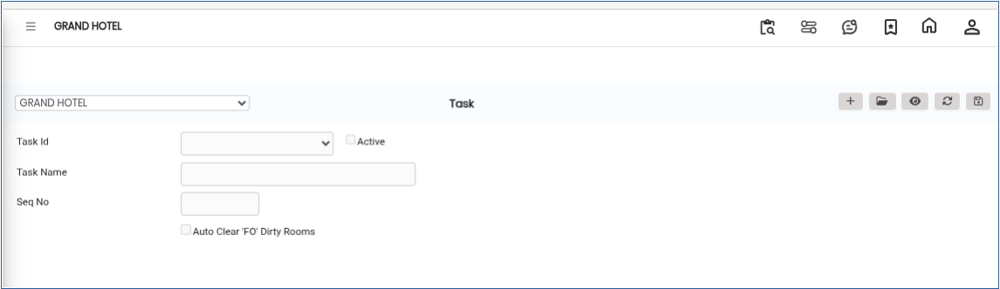
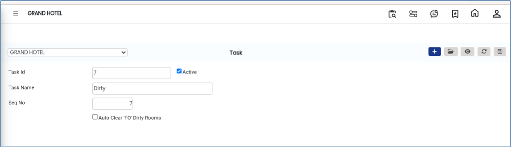

# Tax Master

The **Task Master** option in the Room Cleaning module is used to create and manage housekeeping tasks within the system.These tasks can later be assigned to housekeeping attendants or supervisors for room cleaning and operational activities.

* The Task Master helps standardize housekeeping operations and ensures that all cleaning and maintenance activities are properly tracked.

## Steps to Create a Task in Task Master

Step 1: Go to the **Housekeeping Main Menu**.

1. Click on **Room Cleaning**.
2. Select **Task Master**.

* The Task Master screen will appear&#x20;

<figure><figcaption></figcaption></figure>

Step 2: Click on the **New** button.

Step 3: Choose or enter the **Task ID**.

* The Task ID helps uniquely identify each housekeeping task in the system.

Step 4: Fill in the required task information.

<figure><figcaption></figcaption></figure>

Step 5: After entering all required details, click on the **Save** button.

* Once saved successfully, the task will be created and stored in the Task Master list.

<figure><figcaption></figcaption></figure>
