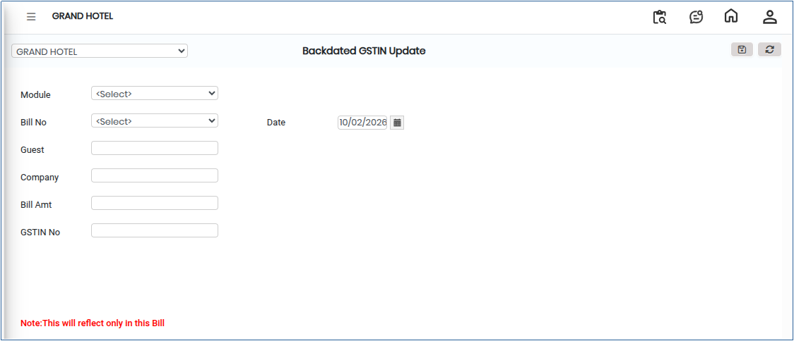

# Backdated GSTIN Update

**Backdated GSTIN Update** refers to the process of updating or correcting a **GST Identification Number (GSTIN)** in the system with an effective date in the past. This ensures that previously recorded transactions are correctly linked to the appropriate GST registration, supporting accurate tax calculation, reporting, and statutory compliance.

## Steps to Update Backdated GSTIN&#x20;

Step 1: Go to the main menu of the application and click on **Settings**.

1. From the Settings menu, select **GST India**.
2. Click on **Purchase Billwise Details** to open the screen.

<figure><figcaption></figcaption></figure>

Step 2: Select the Module

1. A list of available modules will be displayed on the screen.
2. Choose the **relevant module** based on the requirement.

<figure><figcaption></figcaption></figure>

Step 3: After selecting the module, a list of bills will appear.

1. Select the required **Bill Number**.
2. Verify and select the correct **Company Details** associated with the bill.

Step 4: Review the Details

* Ensure the **GSTIN, bill details, and company information** are correct and match the required backdated update.

Step 5: Once all details are confirmed, click on the **Save** button.

* The system will update the GSTIN with the backdated effect for the selected transaction.
