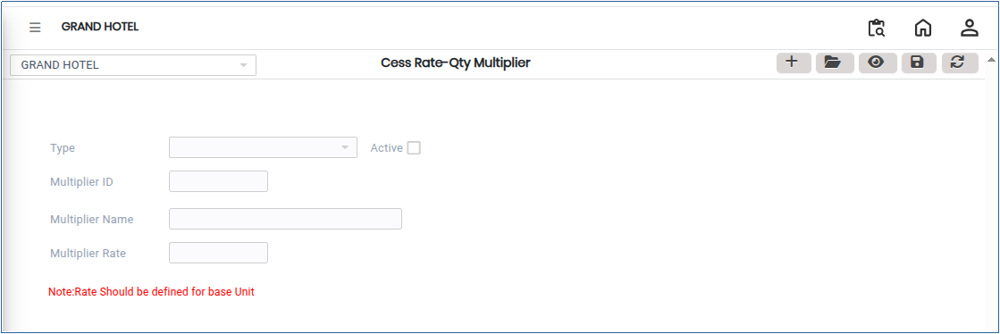
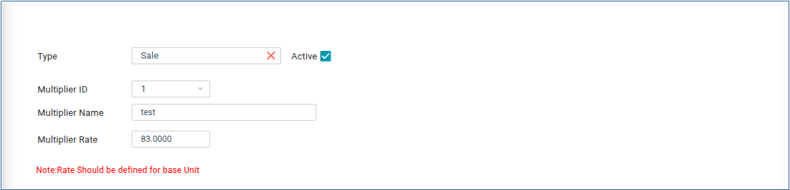

# Cess Rate – Qty Multiplier

**Cess Rate – Qty Multiplier** is a configuration used to calculate the applicable cess (additional tax) on goods based on their quantity or volume. It enables the system to automatically compute the cess amount by multiplying the specified cess rate with the quantity of goods involved in a transaction.

## Steps to Create Cess Rate – Qty Multiplier

Step 1: Go to the main menu of the application and click on **Settings**.

1. From the Settings menu, select **GST India**.
2. Click on **Cess Rate-Qty Multiplier** to open the screen.

<figure><figcaption></figcaption></figure>

Step 2: Click on the **Add** button.

1. Enter the required **Cess Rate** details based on your requirements.
2. Ensure that the entered values are accurate for proper cess calculation.

<figure><figcaption></figcaption></figure>

Step 3: Click on the **Save** button to create the Cess Rate – Qty Multiplier configuration successfully.
