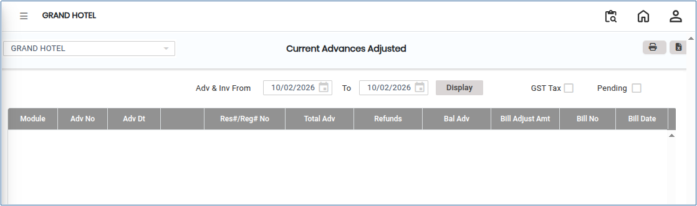
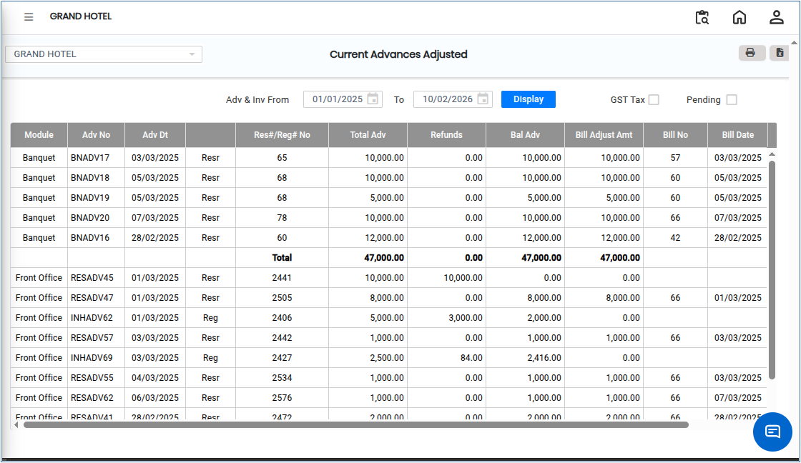

# Current Advances Adjusted

**Current Advances Adjusted** refers to the process of applying previously received advance payments from customers or clients against current invoices or transactions. This ensures that advance amounts are properly accounted for, outstanding balances are reduced accurately, and receivables are correctly reflected in the system.

## Steps to View Current Advances Adjusted

Step 1: Go to the main menu of the application and click on **Settings**.

1. From the Settings menu, select **GST India**.
2. Click on **Current Advances Adjusted** to open the screen.

Step 2: Select the required **From Date** and **To Date** to define the reporting period.

<figure><figcaption></figcaption></figure>

Step 3: Click on the **Display** button.

* The system will display the list of **Current Advances Adjusted** for the selected date range.

<figure><figcaption></figcaption></figure>

Step 4: Export and Print Options.

1. Click on the **Excel** button to download the report in Excel format..png>)
2. Click on the **Print** button to generate the report in PDF format or open it in print view for printing..png>)
