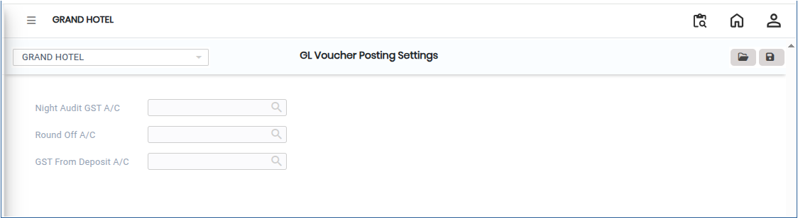
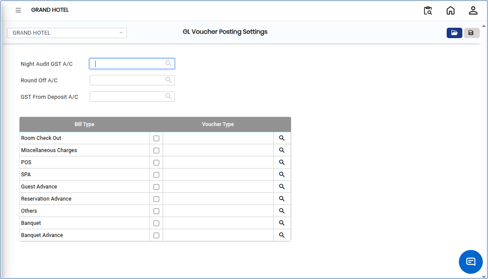
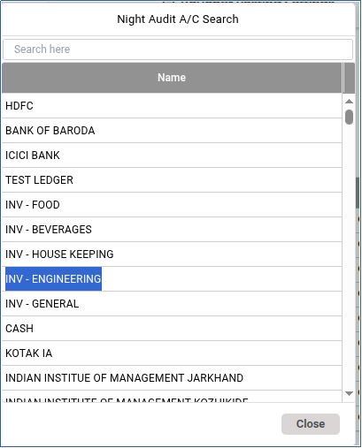
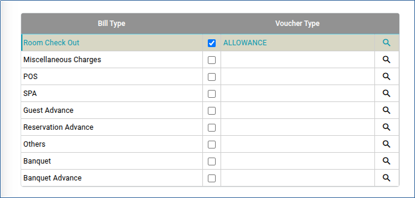

# GL Voucher Posting Settings

**GL Voucher Posting Settings** define the configuration parameters that control how vouchers are recorded and posted in the General Ledger (GL). These settings ensure accurate accounting, proper ledger mapping, and compliance with organisational and statutory accounting rules.

## Steps to Configure GL Voucher Posting Settings

Step 1: Go to the main menu of the application and click on **Settings**.

1. From the Settings menu, select **GST India**.
2. Click on **GL Voucher Posting Settings** to open the screen.

<figure><figcaption></figcaption></figure>

Step 2: Click on **Open** to access the GL Voucher Posting Settings screen.

<figure><figcaption></figcaption></figure>

Step 3: Click on the **Search icon** next to the GST Account field.

1. A list of available **GST Account Numbers** will appear.
2. Select the appropriate account number from the list.

<figure><figcaption></figcaption></figure>

Step 3: After selecting the account name, navigate to the **Bill Type** field.

1. Click on the selection field.
2. Choose the required **Voucher Type** based on the transaction requirement.

<figure><figcaption></figcaption></figure>

Step 4: Review all the selected details carefully.

1. Once confirmed, click on the **Save** button.
