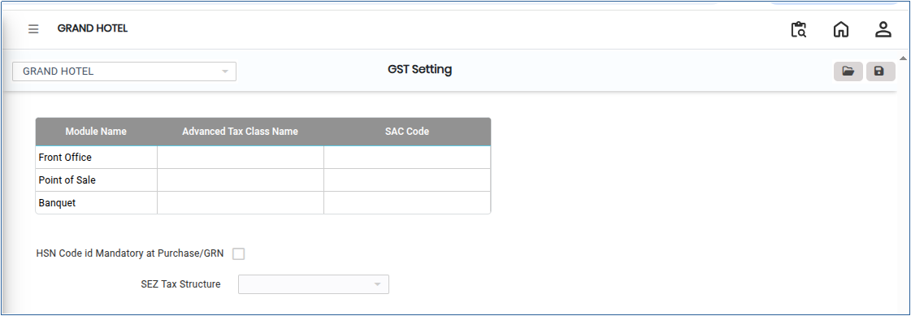
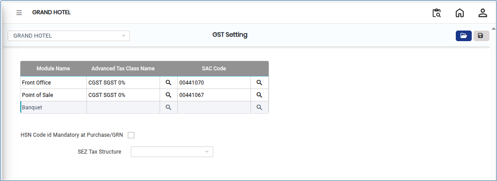
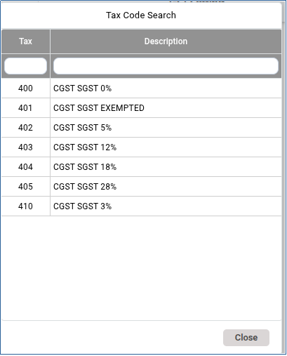
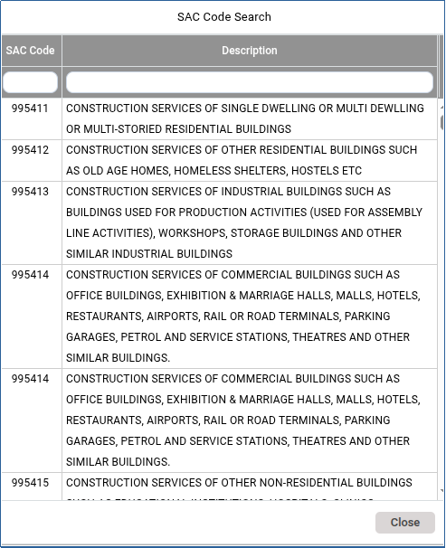
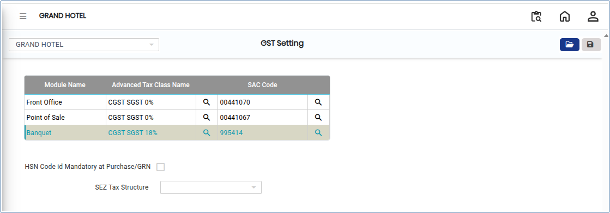

# GST Settings

GST Settings define the configuration parameters required to calculate, apply, and report Goods and Services Tax (GST) within the system. These settings ensure compliance with statutory regulations, accurate tax computation, and proper accounting for all applicable transactions.

## Steps to Configure GST Settings

Step 1: Go to the **Main Menu** of the application and click on **Settings**.

1. From the Settings menu, select **GST India**.
2. Click on **GST Settings** to open the  screen.

<figure><figcaption></figcaption></figure>

Step 2: Click on the **Open** button.

1. Select the required **GST Settings** based on user requirements.

<figure><figcaption></figcaption></figure>

Step 3: Click on the **Search** icon.

1. A list of available GST percentages will be displayed.
2. Select the required **GST percentage** from the list.

<figure><figcaption></figcaption></figure>

Step 4: Click on the **SAC Code** field.

1. A list of available SAC codes will be displayed.
2. Select the appropriate **SAC Code** based on the service category.

<figure><figcaption></figcaption></figure>

Step 5: After completing all selections, verify the entered details.

1. Click on the **Save** button to store the GST Settings in the system.

<figure><figcaption></figcaption></figure>
