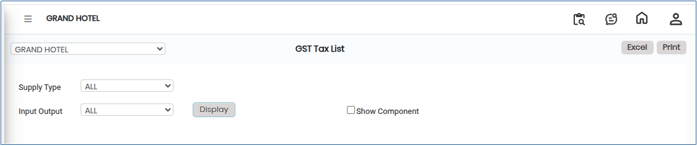

# GST Tax List

The **GST Tax List** is a consolidated record of all Goods and Services Tax (GST) entries configured in the system. It provides a reference for applicable tax rates, tax types, and their mapping to products, services, and ledger accounts.

## Steps to View GST Tax List

Step 1: Go to the main menu of the application and click on **Settings**.

1. From the Settings menu, select **GST India**.
2. Click on **GST Tax List** to open the screen.

Step 2: Select the required **Supply Type** from the available options.

Step 3: Choose the appropriate **Input** or **Output** option based on the tax category you want to view.

Step 4: Click on the **Display** button.

* The system will display the corresponding **GST Tax List** on the screen.

Step 5: Export and Print Options.

1. Click on the **Excel** button to download the report in Excel format..png>)
2. Click on the **Print** button to generate the report in PDF format or open it in print view for printing..png>)

<figure><figcaption></figcaption></figure>
