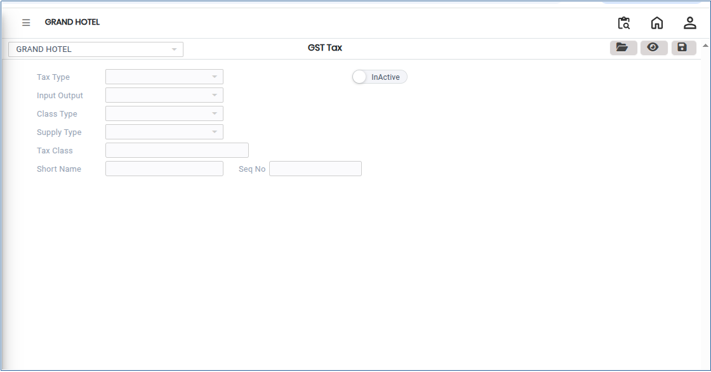
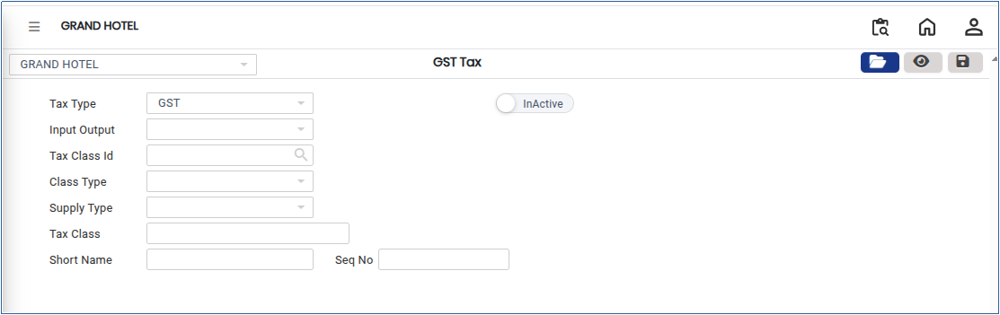
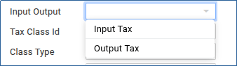
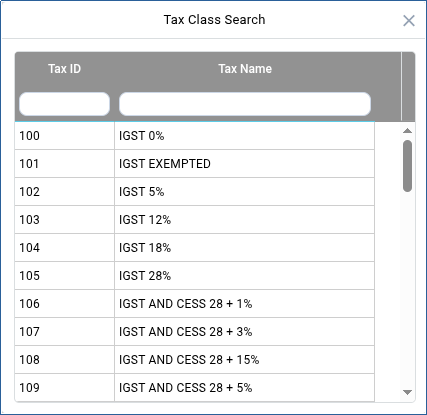
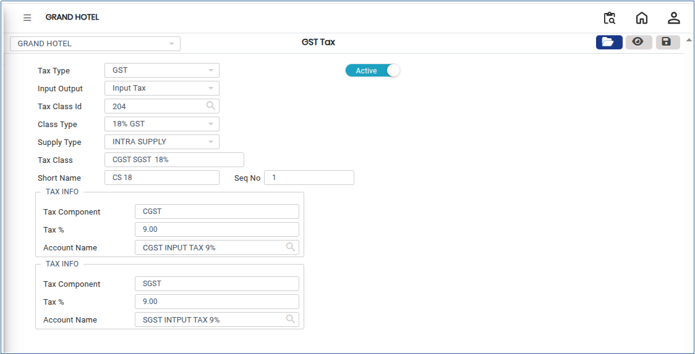

# GST Tax

**Goods and Services Tax** (GST) is an indirect tax applied on the supply of goods and services. It is a value-added tax system that replaces multiple indirect taxes and ensures a uniform tax structure. In the system, GST Tax is configured to accurately calculate, collect, and report tax on applicable transactions.

## **Steps to Configure GST Tax**

Step 1: Go to the main menu of the application and click on **Settings**.

1. Select **GST India,** then click on **GST Tax** option.

<figure><figcaption></figcaption></figure>

Step 2: In the GST Tax screen, click the **Open** button.

1. The system will display the available tax structures.

<figure><figcaption></figcaption></figure>

Step 3: From the list of tax structures shown, select the appropriate tax structure.

1. Next, choose the tax type as:
   * **Input Tax** (tax paid on purchases)
   * **Output Tax** (tax collected on sales)

<figure><figcaption></figcaption></figure>

Step 4: After selecting Input or Output tax, click the **Search icon** next to the **Tax Class ID** field.

1. A new selection window will open.
2. From the list, choose the required **Tax Class ID**.
3. The selected tax class will be applied automatically.

<figure><figcaption></figcaption></figure>

Step 5: After selecting the Tax Class ID, the system will display the corresponding **Tax ID details**.

* Verify all the tax details carefully.
* Ensure that the correct GST rate and configuration are selected.

<figure><figcaption></figcaption></figure>

Step 6: Once all selections are completed and verified, click the **Save** button.

1. The GST Tax setup will be successfully created and stored in the system.
