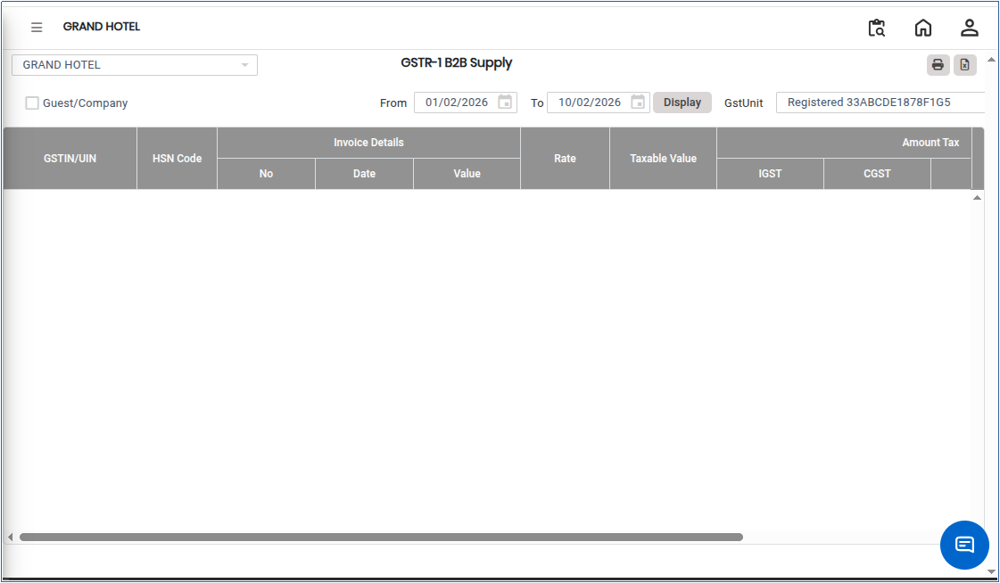
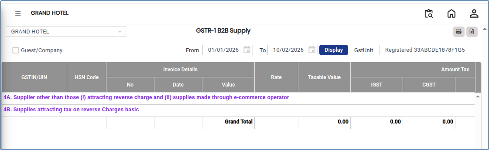

# GSTR-1 B2B Supply

**GSTR-1 B2B Supply** is a report that captures all Business-to-Business (B2B) sales transactions made to registered GST taxpayers. It is part of the statutory GST compliance process and helps businesses report taxable outward supplies accurately to the government.

## Steps to View GSTR-1 B2B Supply

Step 1: Go to the main menu of the application and click on **Settings**.

1. From the Settings menu, select **GST India**.
2. Click on **GSTR-1 B2B Supply** to open the screen.

<figure><figcaption></figcaption></figure>

Step 2: Select the required **From Date** and **To Date** to define the reporting period.

Step 3: Click on the **Display** button.

* The **GSTR-1 B2B Supply** report will appear on the screen.

<figure><figcaption></figcaption></figure>

Step 4: Export and Print Options.

1. Click on the **Excel** button to download the report in Excel format..png>)
2. Click on the **Print** button to generate the report in PDF format or open it in print view for printing..png>)
