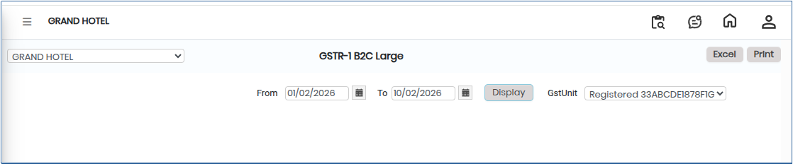
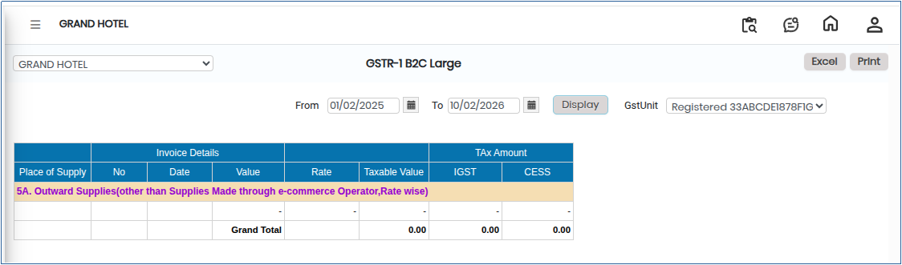

# GSTR-1 B2C Large

**GSTR-1 B2C Large** refers to the reporting of Business-to-Consumer (B2C) sales where the invoice value exceeds the threshold prescribed under GST and the place of supply is outside the seller’s state. These transactions must be reported separately in the GSTR-1 return for GST compliance.

## Steps to View GSTR-1 B2C Large

Step 1: Go to the main menu of the application and click on **Settings**.

1. From the Settings menu, select **GST India**.
2. Click on **GSTR-1 B2C Large** to open the screen.

<figure><figcaption></figcaption></figure>

Step 2: Select the required **From Date** and **To Date** to define the reporting period.

Step 3: Click on the **Display** button.

* The **GSTR-1 B2C Large** report will appear on the screen.

<figure><figcaption></figcaption></figure>

Step 4: Export and Print Options.

1. Click on the **Excel** button to download the report in Excel format.
2. Click on the **Print** button to generate the report in PDF format or open it in print view for printing.
