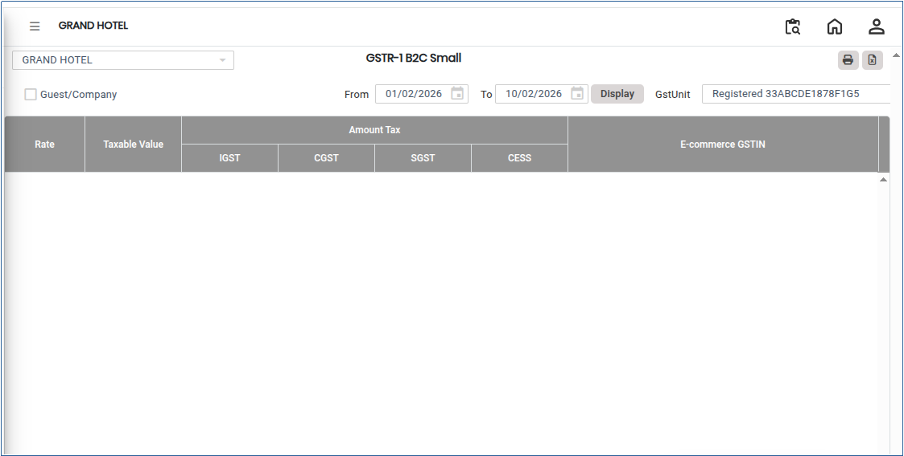
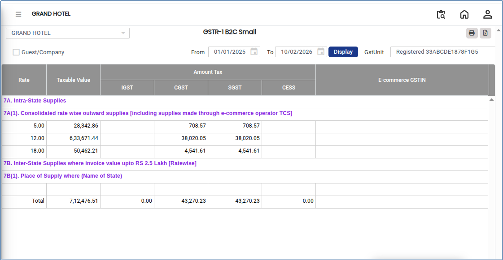

# GSTR-1 B2C Small

**GSTR-1 B2C Small** refers to the reporting of Business-to-Consumer (B2C) sales where the invoice value is within the prescribed GST threshold and the customer is an unregistered person. These transactions are reported in an aggregated manner in the GSTR-1 return as per GST compliance requirements.

## Steps to View GSTR-1 B2C Small

Step 1: Go to the main menu of the application and click on **Settings**.

1. From the Settings menu, select **GST India**.
2. Click on **GSTR-1 B2C Small** to open the screen.

<figure><figcaption></figcaption></figure>

Step 2: Select the required **From Date** and **To Date** to define the reporting period.

Step 3: Click on the **Display** button.

* The **GSTR-1 B2C Small** report will appear on the screen.

<figure><figcaption></figcaption></figure>

Step 4: Export and Print Options.

1. Click on the **Excel** button to download the report in Excel format..png>)
2. Click on the **Print** button to generate the report in PDF format or open it in print view for printing..png>)
