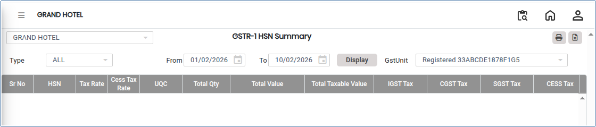
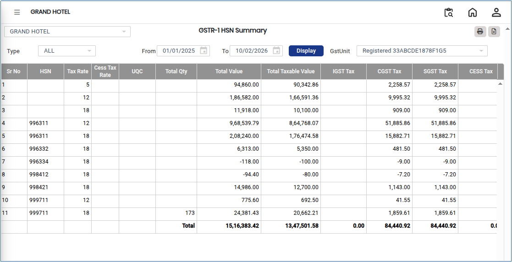

# GSTR-1 HSN Summary

**GSTR-1 HSN Summary** is a report that provides a consolidated view of outward supplies based on **HSN (Harmonized System of Nomenclature) codes**. It is used for GST compliance and statutory reporting. This summary helps in correctly classifying goods and services and ensures accurate tax calculation.

## Steps to View **GSTR-1 HSN Summary**

Step 1: Go to the main menu of the application and click on **Settings**.

1. From the Settings menu, select **GST India**.
2. Click on **GSTR-1 HSN Summary** to open the screen.

<figure><figcaption></figcaption></figure>

Step 2: Select the required **From Date** and **To Date** for which you want to generate the report.

Step 3: After selecting the date range, click on the **Display** button.

* The system will generate and show the HSN-wise summary of outward supplies on the screen.

<figure><figcaption></figcaption></figure>

Step 4: Export and Print Options.

1. Click on the **Excel** button to download the report in Excel format..png>)
2. Click on the **Print** button to generate the report in PDF format or open it in print view for printing..png>)
