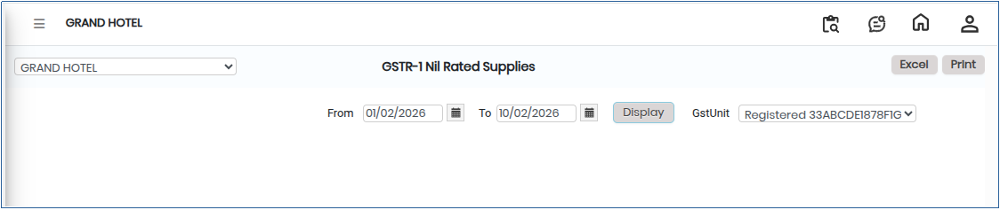
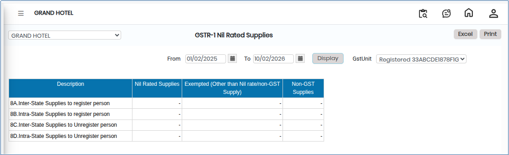

# GSTR-1 Nil Rated Supplies

**GSTR-1 Nil Rated Supplies** refers to the reporting of outward supplies of goods or services that are taxed at **0% GST or are fully exempt from GST**. Even though no tax is charged on these supplies, they must still be properly reported in the GSTR-1 return.

## Steps to View GSTR-1 Nil Rated Supplies

Step 1: Go to the main menu of the application and click on **Settings**.

1. From the Settings menu, select **GST India**.
2. Click on **GSTR-1 Nil Rated Supplies** to open the screen.

<figure><figcaption></figcaption></figure>

Step 2: Select the required **From Date** and **To Date** to define the reporting period.

Step 3: After selecting the date range, click on the **Display** button.

* The system will generate and show the list of Nil Rated Supplies for the selected period on the screen.

<figure><figcaption></figcaption></figure>

Step 4: Export and Print Options.

1. Click on the **Excel** button to download the report in Excel format.
2. Click on the **Print** button to generate the report in PDF format or open it in print view for printing.

