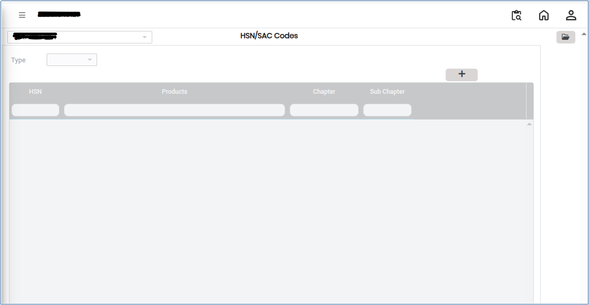
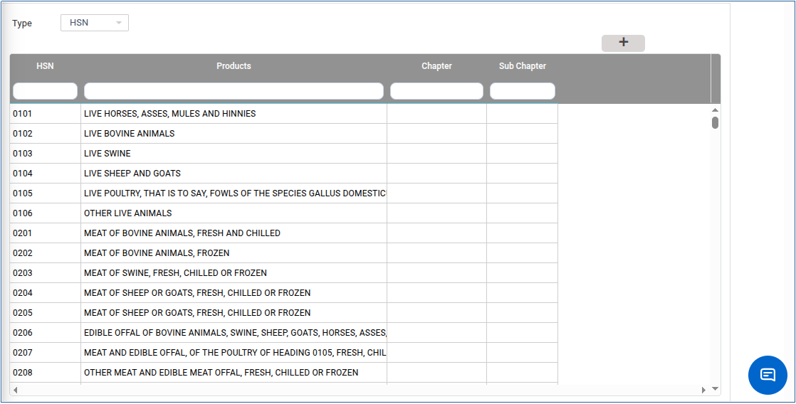
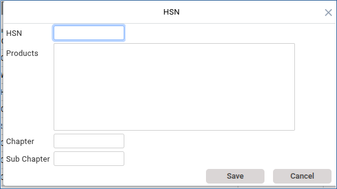

# HSN/SAC Codes

**HSN** (Harmonized System of Nomenclature) and **SAC** (Services Accounting Code) are classification codes used under GST. **HSN codes** are used for **goods** while **SAC codes** are used for **services.**&#x54;hese codes ensure correct GST classification, accurate tax calculation, and proper reporting in invoices and returns.

## Steps to Create HSN/SAC Codes

Step 1: Go to the main menu of the application and click on **Settings**.

1. Select **GST India,** then click on **HSN/SAC** option.

Step 2: In the HSN/SAC setup screen, click the **Open** button.

1. The system will display the available ops for creating and managing HSN/SAC codes.

<figure><figcaption></figcaption></figure>

Step 3: In the setup screen, select the **Type**:

* **HSN** → for Goods
* **SAC** → for Services

1. Choose the correct type based on your requirement.

<figure><figcaption></figcaption></figure>

Step 4: After selecting the Type, click on **Create New** (or Add New option).

1. Enter the required details.

<figure><figcaption></figcaption></figure>

Step 5: After entering all required details, verify the information carefully.

1. Click the **Save** button.
2. The newly created HSN/SAC code will be successfully added to the system.
