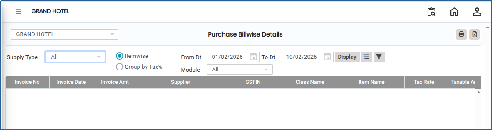
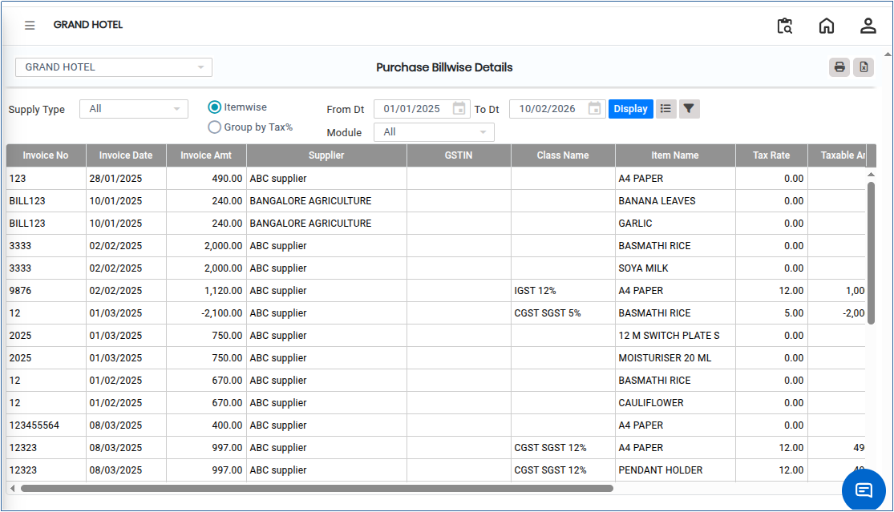

# Purchase Billwise Details

**Purchase Billwise Details** is a detailed report that provides **line-level information for each purchase bill**. It helps in analyzing individual purchase transactions, verifying tax calculations, and reconciling supplier invoices with accounting records in detail.

## Steps to View Purchase Billwise Details

Step 1: Go to the main menu of the application and click on **Settings**.

1. From the Settings menu, select **GST India**.
2. Click on **Purchase Billwise Details** to open the screen.

<figure><figcaption></figcaption></figure>

Step 2: Select the required **From Date** and **To Date** for which you want to generate the report.

Step 3: After selecting the date range, click on the **Display** button.

* The system will generate and display detailed purchase bill information on the screen.

<figure><figcaption></figcaption></figure>

Step 4: Export and Print Options.

1. Click on the **Excel** button to download the report in Excel format..png>)
2. Click on the **Print** button to generate the report in PDF format or open it in print view for printing..png>)
