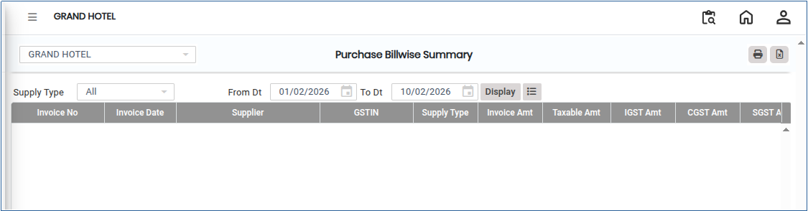
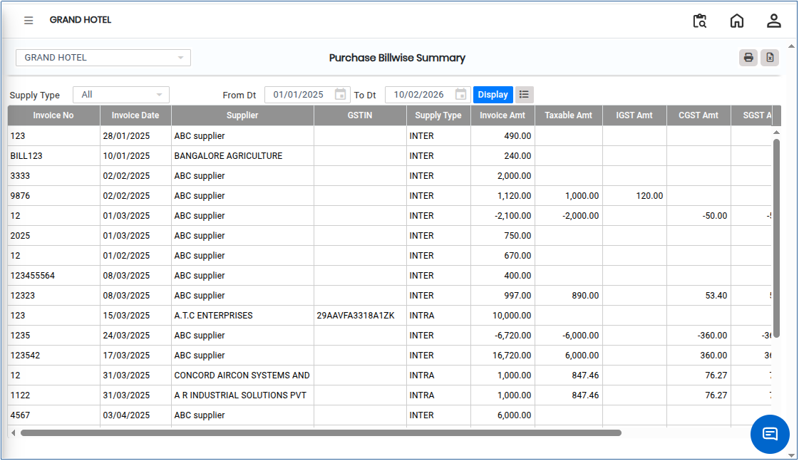

# Purchase Billwise Summary

**Purchase Billwise Summary** is a report that provides a consolidated view of all purchase transactions, summarized **bill by bill**. It helps in tracking supplier invoices, monitoring purchase expenses, and reconciling purchase bills with payments for accurate accounting and financial reporting.

## Steps to View Purchase Billwise Summary

Step 1: Go to the main menu of the application and click on **Settings**.

1. From the Settings menu, select **GST India**.
2. Click on **Purchase Billwise Summary** to open the screen.

<figure><figcaption></figcaption></figure>

Step 2: Select the required **From Date** and **To Date** for which you want to generate the report.

Step 3: After selecting the date range, click on the **Display** button.

* The system will generate and display the bill-wise purchase summary on the screen.

<figure><figcaption></figcaption></figure>

Step 4: Export and Print Options.

1. Click on the **Excel** button to download the report in Excel format..png>)
2. Click on the **Print** button to generate the report in PDF format or open it in print view for printing..png>)
