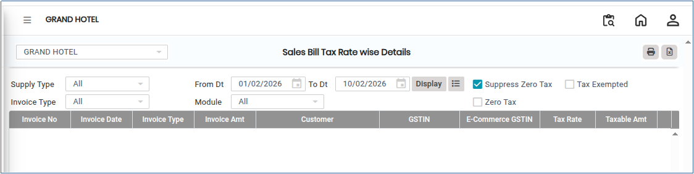
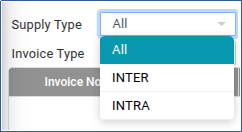
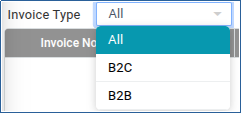
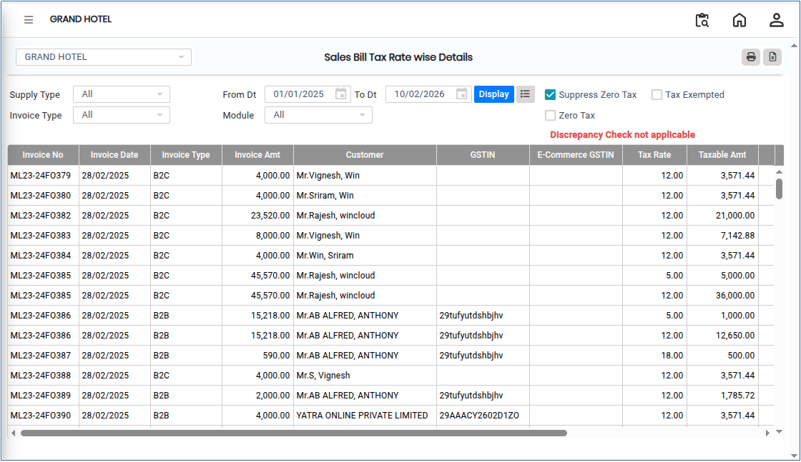

# Sales Bill Tax Rate Wise Details

**Sales Bill Tax Rate Wise Details** is a report that provides a detailed breakdown of sales transactions based on applicable tax rates. It helps in analyzing tax components, ensuring accurate GST or other tax calculations, and supporting compliance with statutory reporting requirements.

## Steps to View Sales Bill Tax Rate Wise Details

Step 1: Go to the main menu of the application and click on **Settings**.

1. From the Settings menu, select **GST India**.
2. Click on **Sales Bill Tax Rate Wise Details**  to open the screen.

<figure><figcaption></figcaption></figure>

Step 2: Click on the **Supply Type** field.

1. Choose the required supply type based on your business requirement.

<figure><figcaption></figcaption></figure>

Step 3: Click on the **Invoice Type** field.

1. Select the required invoice type from the available options.

<figure><figcaption></figcaption></figure>

Step 4: Select the required **From Date** and **To Date** to define the reporting period.

Step 5: Click on the **Display** button.

* The **Sales Bill Tax Rate Wise Details** report will appear on the screen.

<figure><figcaption></figcaption></figure>

Step 6: Export and Print Options

1. Click on the **Excel** button to download the report in Excel format..png>)
2. Click on the **Print** button to generate the report in PDF format or open it in print view for printing..png>)
