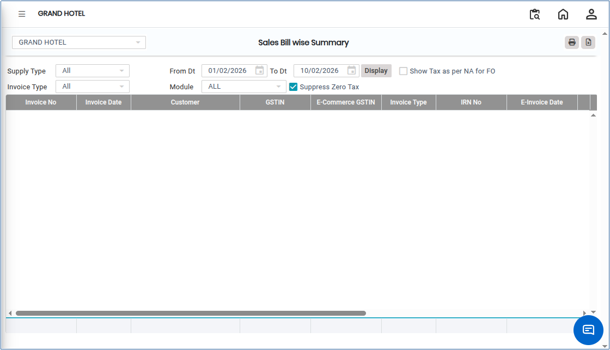
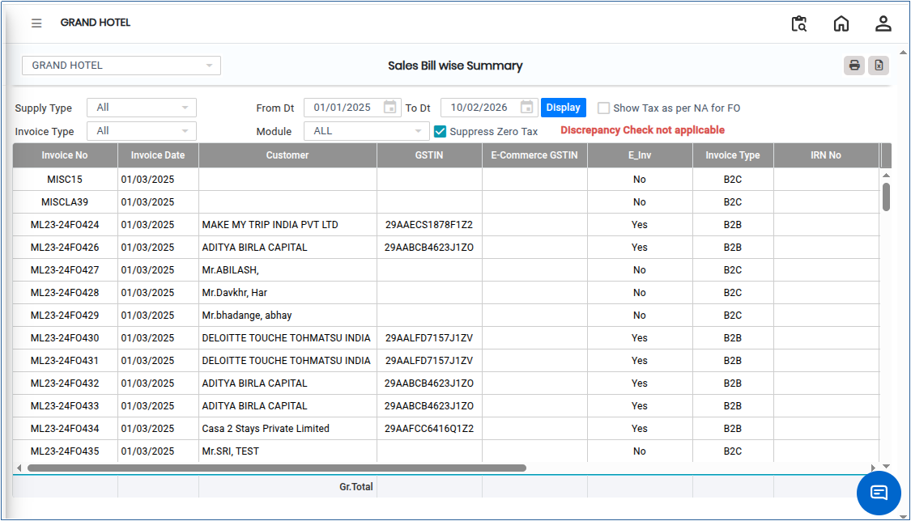

# Sales Bill Wise Summary

**Sales Bill Wise Summary** is a report that provides a consolidated view of all sales transactions, summarised bill by bill. It helps in tracking sales, analysing revenue, and reconciling invoices with payments, enabling accurate financial reporting and management decision-making.

## Steps to View Sales Bill Wise Summary

Step 1: Go to the main menu of the application and click on **Settings**.

1. From the Settings menu, select **GST India**.
2. Click on **Sales Bill Wise Summary** to open the screen.

<figure><figcaption></figcaption></figure>

Step 2: Click on the **Supply Type** field.

1. Choose the required supply type based on your requirement.

<figure><figcaption></figcaption></figure>

Step 3: Click on the **Invoice Type** field.

1. Select the required invoice type from the available options.

<figure><figcaption></figcaption></figure>

Step 4: Select the required **From Date** and **To Date** to define the reporting period.

Step 5: Click on the **Display** button.

* The **Sales Bill Wise Summary** report will appear on the screen.

<figure><figcaption></figcaption></figure>

Step 6: Export and Print Options.

1. Click on the **Excel** button to download the report in Excel format..png>)
2. Click on the **Print** button to generate the report in PDF format or open it in print view for printing..png>)
