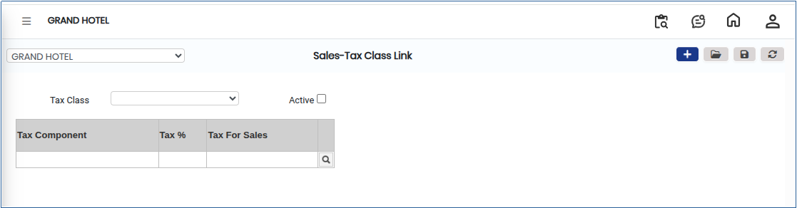
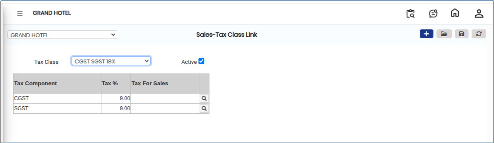

# Sales-Tax Class Link

**Sales–Tax Class Link** defines the association between products or services and their applicable tax classes for sales transactions. This linkage ensures accurate tax calculation, correct reporting, and compliance with statutory regulations during invoicing and billing.

## Steps to Configure Sales-Tax Class Link

Step 1: Go to the main menu of the application and click on **Settings**.

1. From the Settings menu, select **GST India**.
2. Click on **Sales- Tax Class Link** to open the screen.

Step 2: Click on the **Add** button to create a new Sales–Tax Class Link entry.

<figure><figcaption></figcaption></figure>

Step 3: In the Tax Class field, select the appropriate **Tax Class** based on the product or service category.

Step 3: Under the **Tax for Sales** section, click on the **Search icon**.

1. A list of available taxes will be displayed.
2. Choose the appropriate **tax option** required for sales transactions.

<figure><figcaption></figcaption></figure>

Step 4: Verify the selected Tax Class and Sales Tax details.

1. Click on the **Save** button to complete the setup.
