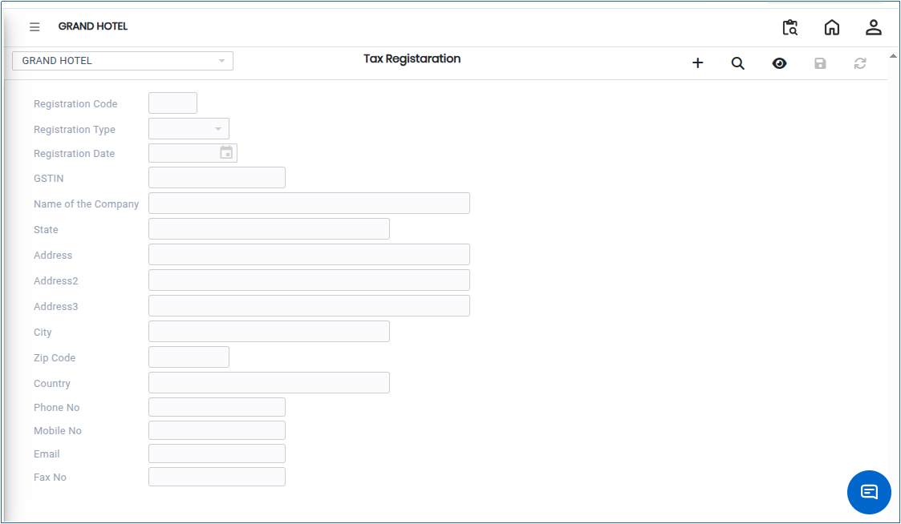
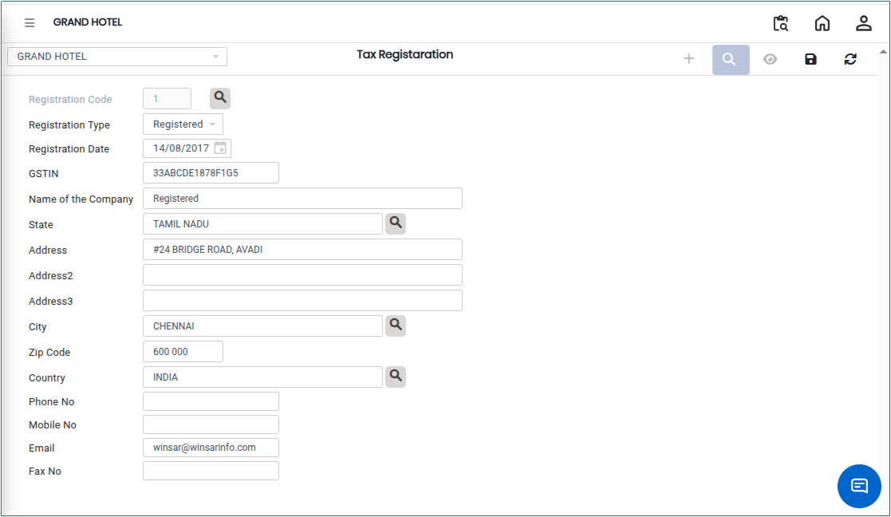

# Tax Registration

Tax Registration is the process of recording an entity’s tax identification details in the system. This helps ensure compliance with statutory requirements, accurate tax calculation, and proper reporting to government authorities.

## Steps to Create Tax Registration

Step 1: Go to the main menu of the application and click on **Settings**.

1. Inside Settings, select **GST India** from the available options.
2. Click on **Tax Registration** to open the screen.

<figure><figcaption></figcaption></figure>

Step 2: Click on the **Add** button.

1. Enter all required **GST Tax Registration details** in the form.\
   Make sure all mandatory fields are filled correctly.

<figure><figcaption></figcaption></figure>

Step 3: Once all details are entered:

1. Review the information carefully.
2. Click on the **Save** button to create the Tax Registration successfully.
