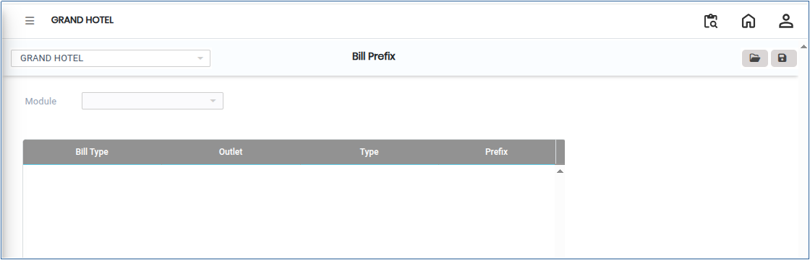
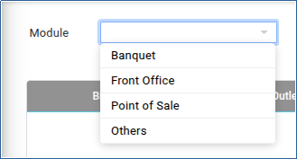
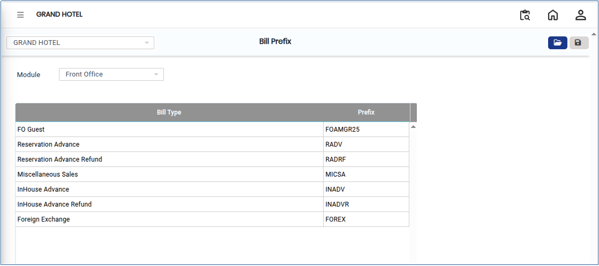

# Bill Prefix

The **Bill Prefix** is a configurable code or set of characters added at the beginning of a bill or invoice number to uniquely identify, categorise, or differentiate documents. It helps organisations track, and manage transactions across different departments, locations, or document types.

## Steps to Configure Bill Prefix

Step 1: Log in to the application.

1. Go to the **Settings** section from the main menu.
2. Under **Masters**, click on **Bill Prefix**.

* The Bill Prefix screen will open.

<figure><figcaption></figcaption></figure>

Step 2: Click on the **Open** button available on the screen.

1. A list of available modules will appear.
2. Select the required module for which the Bill Prefix needs to be configured.

<figure><figcaption></figcaption></figure>

Step 3: Once the module is selected, the configuration screen will appear.

1. Enter the required prefix in the respective field.

* Ensure that the prefix format follows organisational standards.

<figure><figcaption></figcaption></figure>

Step 4: After completing the configuration, click on the **Save** button.

1. The system will save the Bill Prefix successfully.
