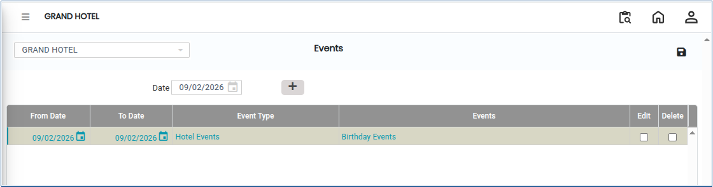

# Events

The **Events Module** is used to record and manage organisational or system-related events. It helps in tracking important activities by storing details such as event type, duration, and description. This module also supports modification and deletion of events when required, ensuring accurate operational tracking and reporting.

## Steps to Create an Event

Step 1: Go to the **Settings** section&#x20;

1. Open the **Master** module. From there, select the **Events Module**.

Step 2: Click on the **Add** button to create a new event entry.

<figure><figcaption></figcaption></figure>

Step 3: Enter the required information based on user needs

* Ensure all details are entered correctly to maintain accurate event tracking.

<figure><figcaption></figcaption></figure>

Step 4: After entering all required details, click the **Save** button to store the event in the system.
