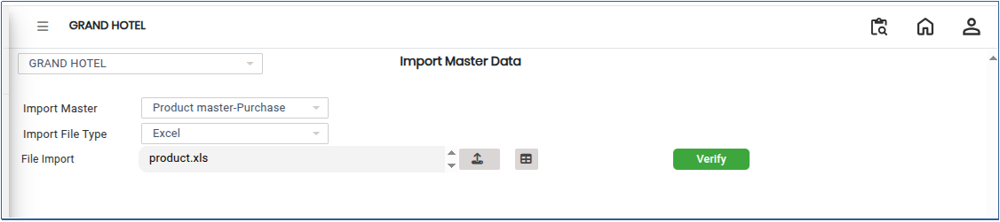

# Import Masters

The **Import Master Data** feature allows users to upload and integrate structured data from external sources into the system. It helps organisations efficiently create and manage master records such as products, customers, suppliers, vendors, and other business data.

## Steps to Import Master Data

Step 1: Log in to the application.

1. Go to the **Settings** section from the main menu.
2. Under **Masters**, click on **Import Master Data**.

* The Import Master Data screen will open.

<figure><figcaption></figcaption></figure>

Step 2: In the **Import Name** field, select the required master data type from the drop down list.

* Select the appropriate import category based on the data you want to upload.

<figure><figcaption></figcaption></figure>

Step 3: Choose the required **Import Type**.

<figure><figcaption></figcaption></figure>

Step 4: Click on the **Browse** or **Choose File** button.

1. Select the file to be imported from your system.

<figure><figcaption></figcaption></figure>

Step 4: After selecting the file, click on the **Map** button. 

1. The system will display the file columns and corresponding system fields.
2. Map each column correctly to the respective system field.
3. Verify that all required fields are mapped properly.

<figure><figcaption></figcaption></figure>

Step 5: Once the mapping is completed, click on the **Verify** button.

1. The system will validate the uploaded data.
2. If any errors are found, the system may display validation messages.

<figure><figcaption></figcaption></figure>
