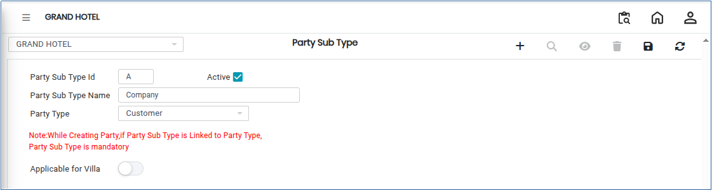

# Party Sub Type Master

The **Party Sub Type** is a detailed classification under a Party Type that allows finer categorisation of business partners such as customers, suppliers, or vendors. It helps in accurate transaction handling, reporting, and accounting by distinguishing parties based on specific characteristics or business rules.

## Steps to Create a Party Sub Type

Step 1: Log in to the application.

1. Go to the **Settings** section from the main menu.
2. Under **Masters**, click on **Party Sub Type**.

* The Party Sub Type screen will open.

<figure><figcaption></figcaption></figure>

Step 2: Click on the **Add** button available on the screen.

* A new Party Sub Type entry form will open.

Step 3: Enter the required details in the respective fields.

1. Select the appropriate **Party Type**.
2. Enter the **Party Sub Type** name and other necessary information as required by the system.

* Ensure that all mandatory fields are filled correctly.

<figure><figcaption></figcaption></figure>

Step 4: Once all details are entered, click on the **Save** button.

1. The system will save the Party Sub Type successfully.
