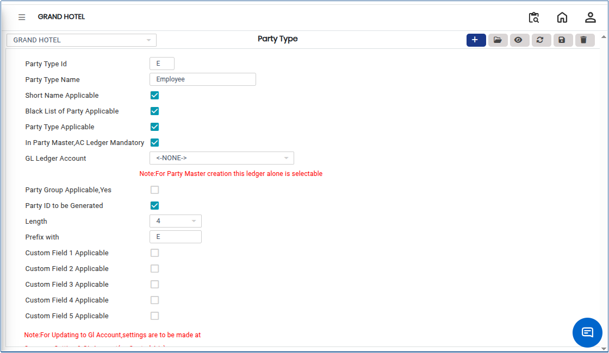

# Party Type Master

The **Party Type** defines the classification of an entity involved in business transactions, such as a customer, supplier, vendor, or other business partner. It helps the system identify the role of the party, apply relevant accounting rules, and manage transactions accurately.

## Steps to Create a Party Type

Step 1: Log in to the application.

1. Go to the **Settings** section from the main menu.
2. Under **Masters**, click on **Party Type**.

* The Party Type screen will open.

<figure><figcaption></figcaption></figure>

Step 2: Click on the **Add** button available on the screen.

* A new Party Type entry form will open.

Step 3: Enter the required details in the respective fields.

1. Provide the Party Type name and other necessary information as required by the system.

* Ensure that all mandatory fields are filled correctly.

<figure><figcaption></figcaption></figure>

Step 4: Once the details are entered, click on the **Save** button.

* The system will save the Party Type successfully.
