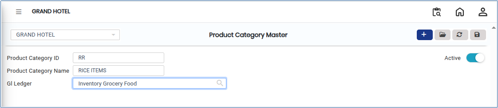

# Product Category

The **Product Category** is used to classify products based on shared characteristics. It helps in organizing products efficiently and supports better management of inventory, reporting, pricing, and accounting within the system. Each product category is linked with a **GL (General Ledger) account**, which ensures accurate financial tracking.

## Steps to Create a Product Category

Step 1: Go to the **Settings** section&#x20;

1. Open the **Master** module. From there, select **Product Category Master**.

Step 2: Click on the **Add** button to create a new product category.

<figure><figcaption></figcaption></figure>

Step 3: A form will appear after clicking the Add button. Enter the required details, such as:

* **Product Category ID**
* **Product Category Name**

Step 4: Choose the appropriate **GL (General Ledger) account** from the available list.

* This step is important because it ensures that all financial transactions related to the product category are correctly recorded in the accounting system.

<figure><figcaption></figcaption></figure>

Step 5: After entering all required details and selecting the GL Ledger, click the **Save** button to create the product category.
