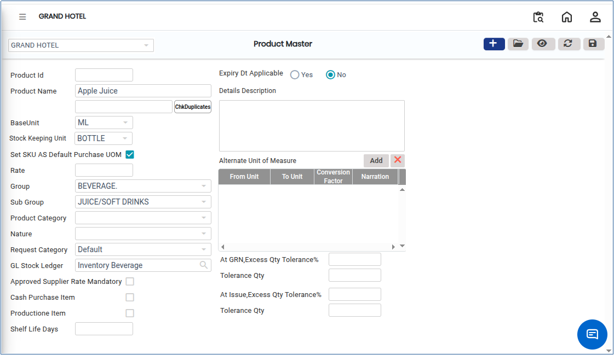

# Product Master

The **Product Master** is a centralised repository that stores complete and detailed information about each product in the system. It supports key business operations such as **inventory management, procurement, accounting, pricing, and reporting** by maintaining all essential product attributes in one place.

## Steps to Create a New Product

Step 1: Go to the **Settings** section. &#x20;

1. Open the **Master** module. From there, select **Product Master**.

Step 2: Click on the **Add** button to create a new product entry in the system.

<figure><figcaption></figcaption></figure>

Step 3: A product creation form will appear after clicking the Add button. Enter all required product information as per user needs.

* Ensure all details are entered accurately to maintain proper classification and control.

<figure><figcaption></figcaption></figure>

Step 4: After entering all required details, click the **Save** button to create the new product in the system.
