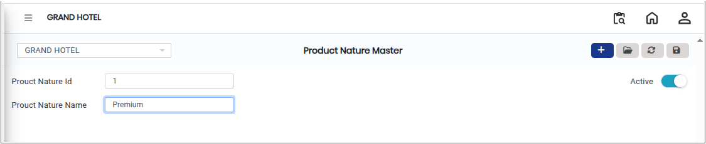

# Product Nature

The **Product Nature Master** is used to define the inherent nature of a product, such as **Goods, Services, Consumables, or Assets**. This classification helps the system handle products correctly for **taxation, accounting treatment, inventory management, and reporting purposes**.

## Steps to Create Product Nature

Step 1: Go to the **Settings** section&#x20;

1. Open the **Master** module. From there, select **Product Nature Master**.

Step 2: Click on the **Add** button to create a new product nature entry.

<figure><figcaption></figcaption></figure>

Step 3: A form will appear after clicking the Add button. Enter the required details, such as:

* **Product Nature Id**&#x20;
* **Product Nature Name**

Ensure that the details entered correctly represent the type of product being defined.

<figure><figcaption></figcaption></figure>

Step 4: After entering all required details, click the **Save** button to create the product nature in the system.
