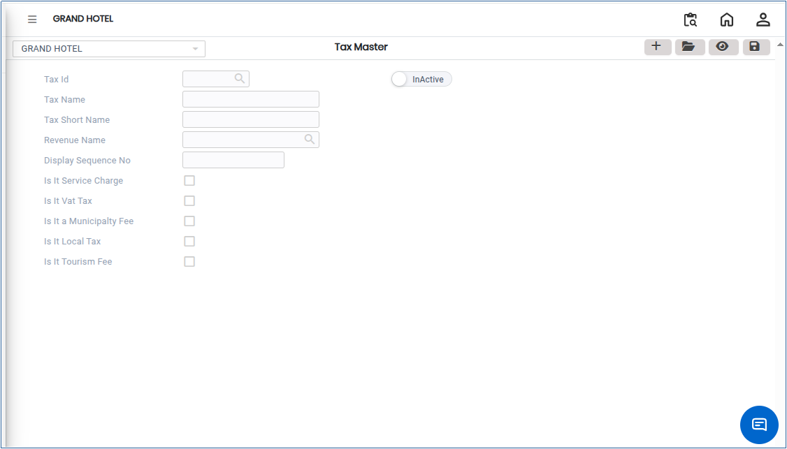

# Tax Master

The **Tax Master** is a centralised record that defines all applicable taxes in the system, including their types, rates, and calculation rules. It helps ensure accurate tax calculation, compliance with regulatory requirements, and proper accounting treatment across all business transactions.

## Steps to Create a Tax Master

Step 1: Log in to the application.

1. Go to the **Settings** section from the main menu.
2. Under **Masters**, click on **Tax Master**.

* The Tax Master screen will open.

<figure><figcaption></figcaption></figure>

Step 2: Click on the **Add** button available on the screen.

* A new Tax Master entry form will open.

Step 3: Enter the required tax information in the respective fields.

* Ensure that all mandatory fields are filled correctly.

<figure><figcaption></figcaption></figure>

Step 4: Once all required details are entered, click on the **Save** button.

1. The system will save the Tax Master successfully.
