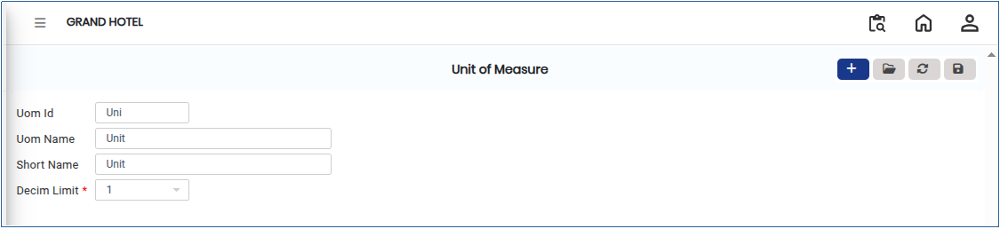

# UOM

The **Unit of Measure (UOM)** represents the standard unit used to quantify an item, service, or transaction. It ensures consistency in pricing, inventory management, reporting, and overall system operations.

## Steps to Create UOM

Step 1: Go to the **Settings** section&#x20;

1. Open the **Master** module. From there, select **Unit of Measure (UOM)**.

Step 2: Click on the **Add** button to create a new unit of measure.

<figure><figcaption></figcaption></figure>

Step 3: Enter the required details in the fields provided, such as:

* **UOM Id**
* **UOM Name**
* Any additional required fields shown in the form.

Ensure that the information entered is accurate and follows the system’s naming conventions.

<figure><figcaption></figcaption></figure>

Step 4: After entering all required details, click the **Save** button to store the newly created UOM in the system.
