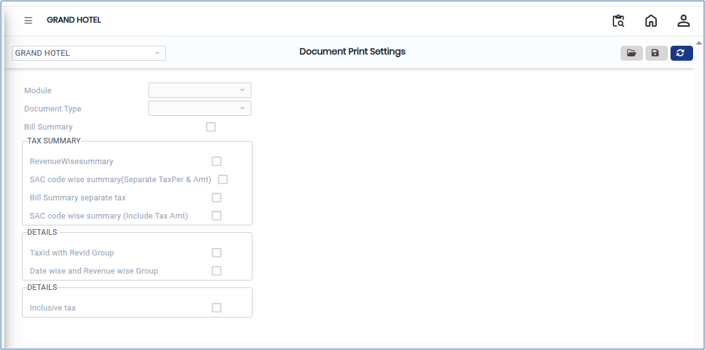
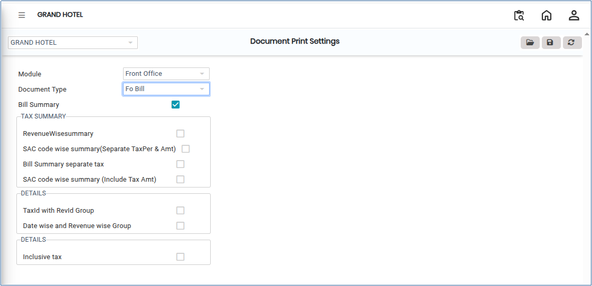
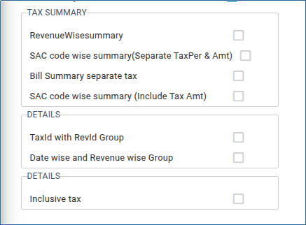

# Document Print Settings

**Document Print Settings** are used to configure how system documents are printed. These settings help maintain a consistent format, layout, and print structure for documents such as Invoices, Purchase Orders, Receipts, Reports and Other system-generated documents.

## Steps to Configure Document Print Settings

Step 1: Go to **Settings** in the main menu.

1. Click on **Privileges**.
2. Select **Document Print Settings** from the list.

* The Document Print Settings screen will open.

<figure><figcaption></figcaption></figure>

Step 2: Click the **Open** button.

1. Select the required:
   * **Module**
   * **Document Type**

The selected document configuration will be displayed.

<figure><figcaption></figcaption></figure>

Step 3: After selecting the document type, configure the required print settings.

1. Enable the **Summary** option if you want only summarised information to appear in the printed document.
2. Enable the **Details** option if you want complete detailed information to appear in the printed document.
3. You may enable:

* Only **Summary**
* Only **Details**
* Both **Summary and Details**

Select the options according to you requirements.

<figure><figcaption></figcaption></figure>

Step 4: After completing the configuration, click the **Save** button.

1. The system will save the updated print settings successfully.
