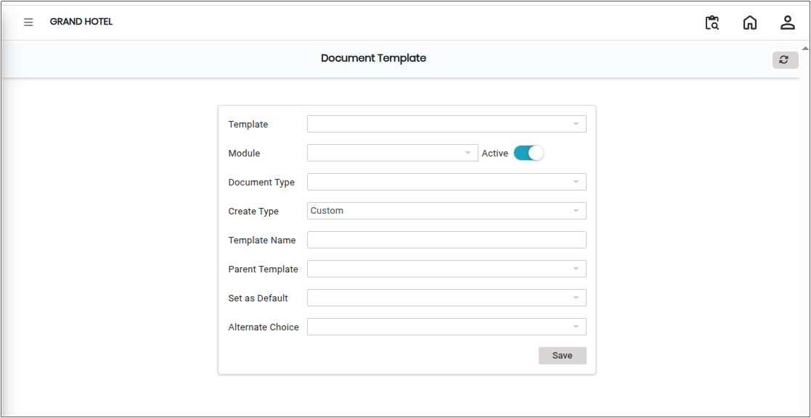
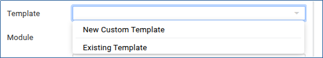
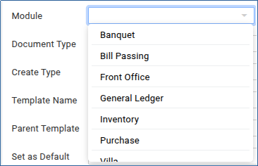
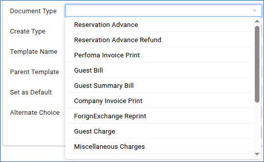
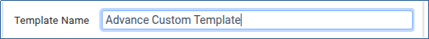
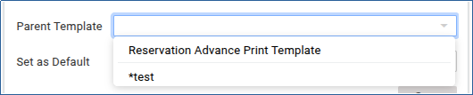
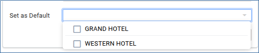

# Document Template

A **Document Template** defines a predefined and standardised format used for generating system documents such as invoices, purchase orders, receipts, reports, and letters. It helps maintain consistency in layout, content, branding, and compliance across all generated documents.

## Steps to Create a Document Template

Step 1: Go to the **Main Menu** in the application and click **Settings**.

1. Under Settings, select **Privileges**.
2. Click on **Document Template**.

This will open the Document Template configuration screen.

<figure><figcaption></figcaption></figure>

Step 2: In the Template section, choose the required template type from the available options.

<figure><figcaption></figcaption></figure>

Step 3: After selecting the template, choose the appropriate **Module**.

* Select the module based on your requirement.

<figure><figcaption></figcaption></figure>

Step 4: Click on the **Document Type** field.

1. Choose the required document from the list available.

<figure><figcaption></figcaption></figure>

Step 5: In the **Template Name** field, enter a unique and meaningful name for the new template.

* Using a proper naming convention helps identify templates easily in the future.

<figure><figcaption></figcaption></figure>

Step 6: Click on the **Parent Template** field.

1. Select an existing template from the list.

* The parent template acts as the base structure for the new template. It helps inherit predefined settings, layouts, and formatting.

<figure><figcaption></figcaption></figure>

Step 7: Select the **Default Property** option if you want this template to be used as the default document template.

<figure><figcaption></figcaption></figure>

Step 8: After entering all required details, review the information carefully.

1. Click on the **Save** button to create the new document template.
