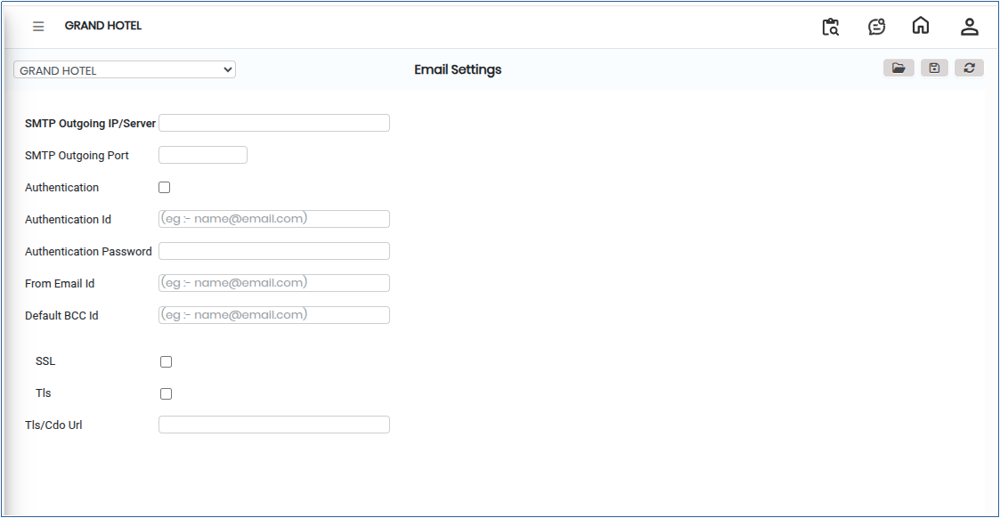
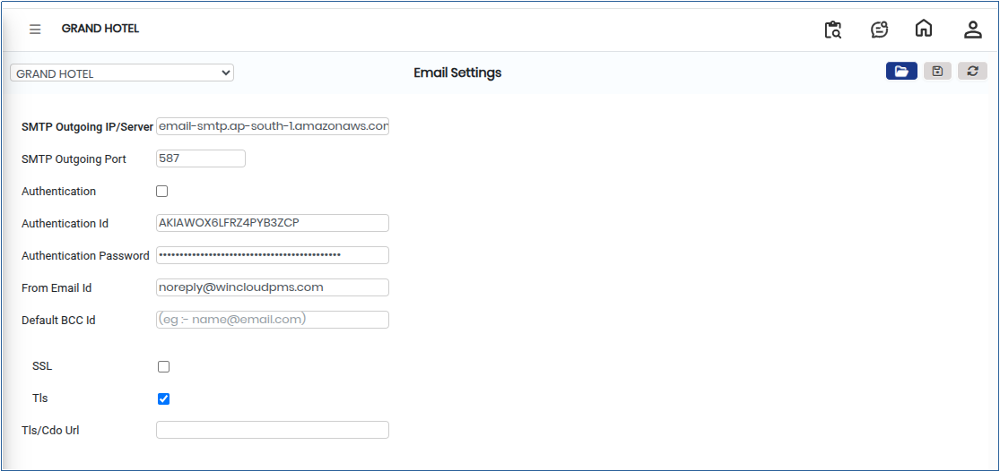

# Email Settings

**Email Settings** define the configuration required to enable and manage system-generated email notifications. This setup ensures that emails such as alerts, approvals, reports, and transactional communications are sent reliably and securely to the intended recipients.

## Steps to Configure Email Settings

Step 1: Log in to the application, from the **Main Menu**, go to **Settings**.

1. Click on **Privileges** and select **Email Settings** from the available options.

Step 2: Click the **Open** button.

1. The **Email Settings** screen will be displayed.

* This page allows users to configure the required email server and notification details.

<figure><figcaption></figcaption></figure>

Step 3: Enter the required email configuration details in the respective fields.&#x20;

* Ensure that all information entered is accurate to avoid email delivery issues.

<figure><figcaption></figcaption></figure>

Step 4: After entering all the required details, review the information carefully.

1. Click the **Save** button to store the configuration.
