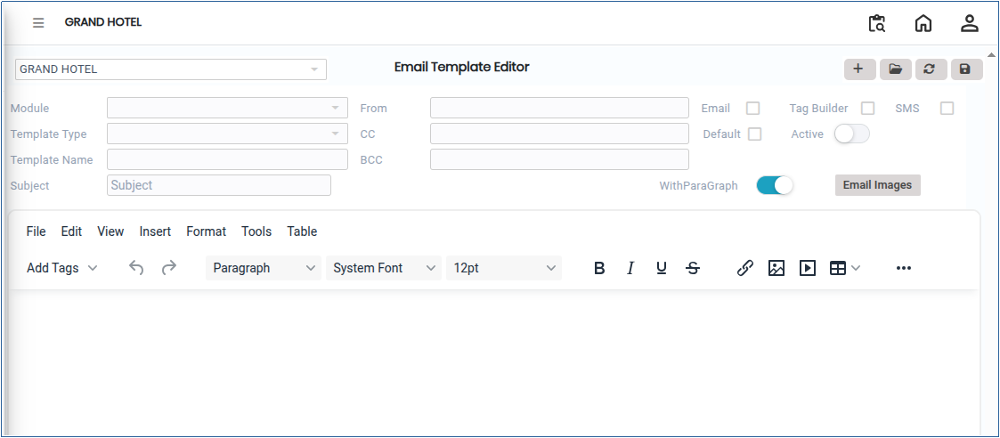
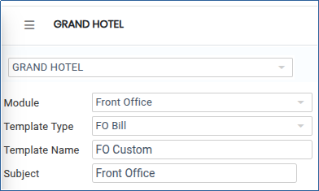
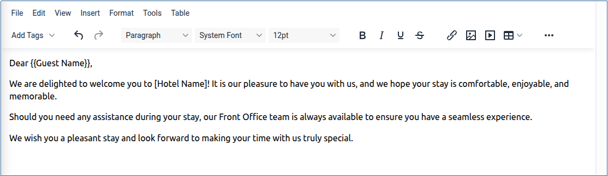
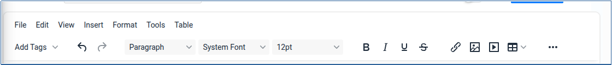

# Email Template Editor

The **Email Template Editor** is a configurable tool used to create, modify, and manage email templates for system-generated communications. It allows users to design email content, format the email layout, and map dynamic data fields to ensure professional, consistent, and automated email notifications.

## Steps to Configure Email Templates

Step 1: Go to the main menu in the application and click on **Settings**.

1. Select **Privileges,** then click on **Email Template Editor**.

The Email Template Editor screen will open.

<figure><figcaption></figcaption></figure>

Step 2: Click the **Add** button.

1. Select the required details:
   * **Module**
   * **Template Type**
   * **Template Name**
2. Enter the **Subject** for the email template.

* These details define the purpose and category of the email template.

<figure><figcaption></figcaption></figure>

Step 3: In the text editor section, enter the email content as per your requirement.

* Ensure the content is clear, professional, and properly formatted.

<figure><figcaption></figcaption></figure>

Step 4: Select the required formatting tools and editor options available in the toolbar.

* These tools help create a well-structured and professional email template.

<figure><figcaption></figcaption></figure>

Step 5: Enter the **From Email Address** and **To Email Address**.

* Ensure that the email addresses are entered correctly for successful email communication.

Step 6: After completing all configurations, click the **Save** button.

1. The system will save the email template successfully.

* The saved template can now be used for automated system-generated emails.
