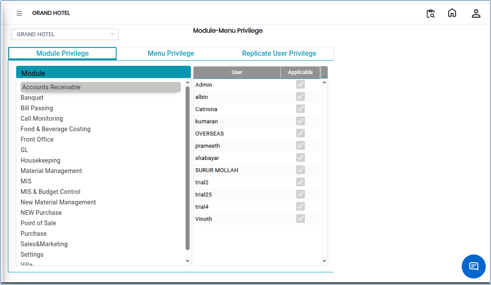
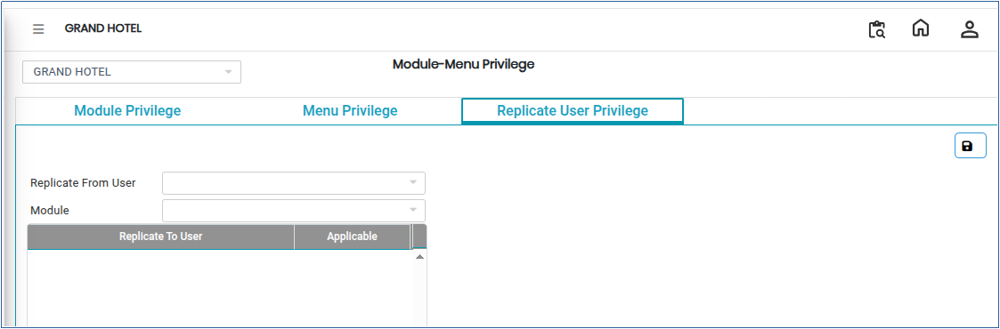
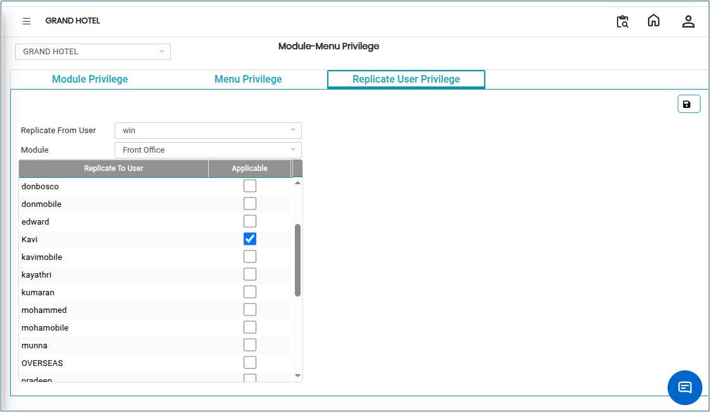

# Menu Privilege

Module–Menu Privilege is used to control user access within the system. It allows administrators to define what modules, menus, and actions a user can access based on their role. This helps ensure system security, proper authorisation, and controlled access to functionalities.

## Steps to Configure Module–Menu Privileges

Step 1: Go to the **Settings** menu in the system.

1. Click **Privilege,** then select **Menu Privilege.**

* The Menu Privilege screen will open.

Step 2: First, select the **Module** from the available list.

1. Next, select the **User** to whom you want to assign access rights.
2. After selection, the system will display the available **module rights and permissions** for that user.

<figure><figcaption></figcaption></figure>

Step 3: After selecting the module and user, click on **Menu Privilege**.

1. A new screen will appear showing the list of menus and available permissions.
2. Here, you can define what menus and actions the selected user is allowed to access.

<figure><figcaption></figcaption></figure>

Step 4: If you want to copy privileges from an existing user, click on **Replicate User Privilege**.

1. The replication screen will be displayed.
2. Select the **User (Source User)** whose privileges you want to copy.
3. Then select the **Module** for which privileges should be replicated.

<figure><figcaption></figcaption></figure>

* The system will display the selected user’s existing privileges for that module.

Step 5: Review the replicated or selected privileges carefully.

1. Modify permissions if required based on the new user’s access needs.
2. Ensure all required menu rights are correctly assigned.

<figure><figcaption></figcaption></figure>

Step 6: Once all privileges are finalised, click the **Save** button.
