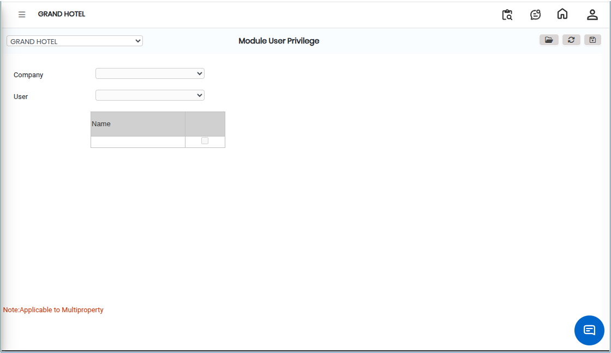
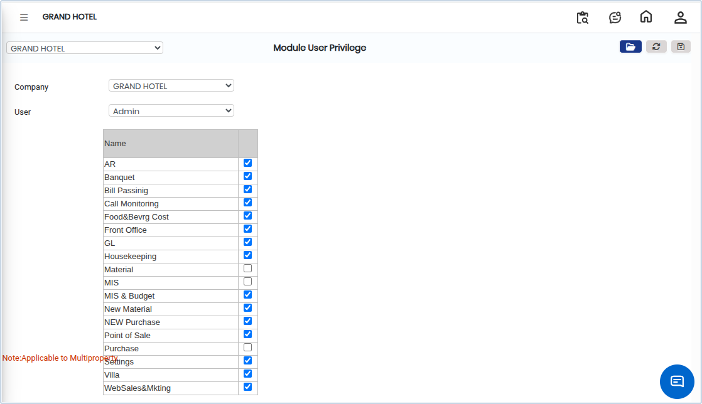

# Module User Privilege

**Module User Privilege** is used to control and manage what a user can do inside different system modules. It defines permissions such as viewing, creating, editing, approving, or deleting records. This ensures proper security, role-based access, and segregation of duties within the system.

## Steps to Assign Module User Privileges

Step 1: Go to the **Main Menu** of the application and click on **Settings**.

1. Under the Settings menu, click on **Privileges**.
2. From the available options, select **Module User Privilege**.

Step 2: Click on the **Open** button. 

<figure><figcaption></figcaption></figure>

Step 3: Choose the required **Company Name** from the list.

<figure><figcaption></figcaption></figure>

Step 4: Select the **User** for whom the privileges need to be assigned.

1. After selecting the user, the system will display available modules and their permission options.

<figure><figcaption></figcaption></figure>

Step 5: After assigning the required permissions, click on the **Save** button.

* The system will store the assigned module privileges for the selected user.
