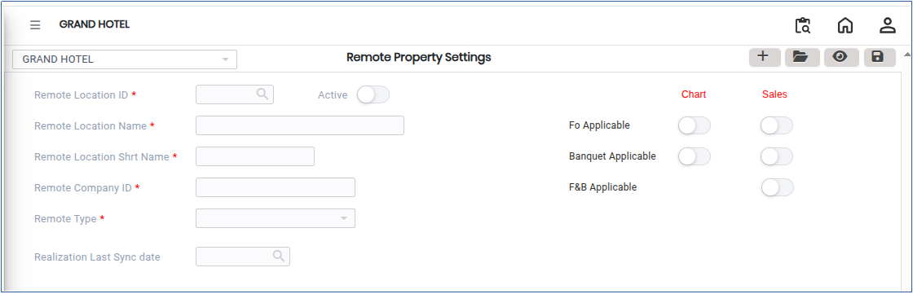
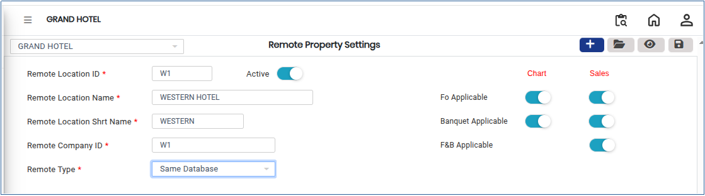

# Remote Property Settings

**Remote Property Settings** are used to configure and manage communication between a central system and one or more remote properties. These settings help ensure smooth data synchronisation, centralised control, and consistent operations across multiple locations.

## Steps to Configure Remote Property Settings

Step 1: Go to the main menu and click on **Settings**.

1. Select **Privileges,** then click on **Remote Property Settings**.

* The Remote Property Settings screen will be displayed.

<figure><figcaption></figcaption></figure>

Step 2: Click the **Add** button.

1. Enter the required details for the remote property configuration.

* Ensure all mandatory fields are filled correctly.

<figure><figcaption></figcaption></figure>

Step 3: After entering all required details, click the **Save** button.

1. The system will store the remote property settings successfully.
